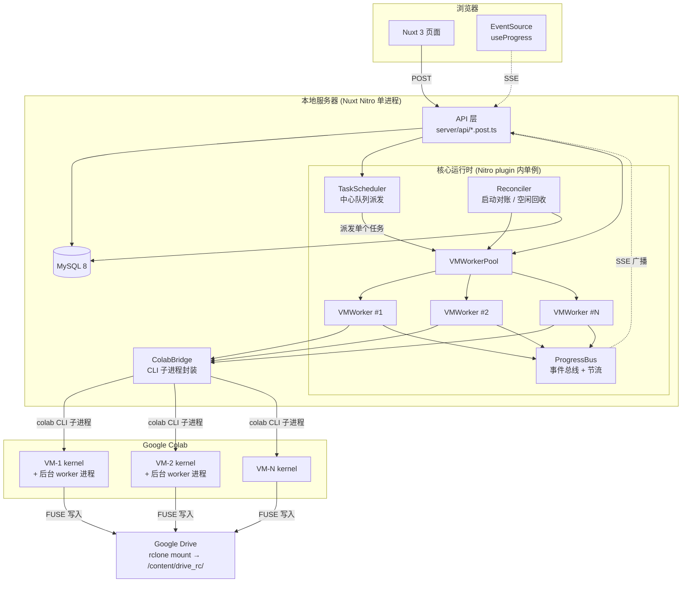
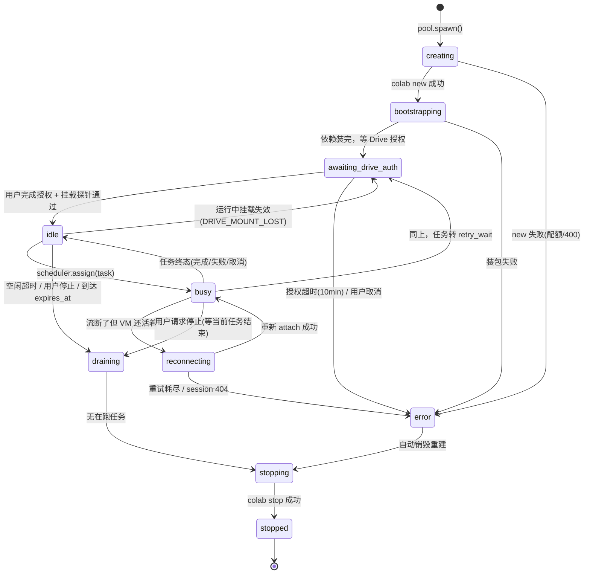
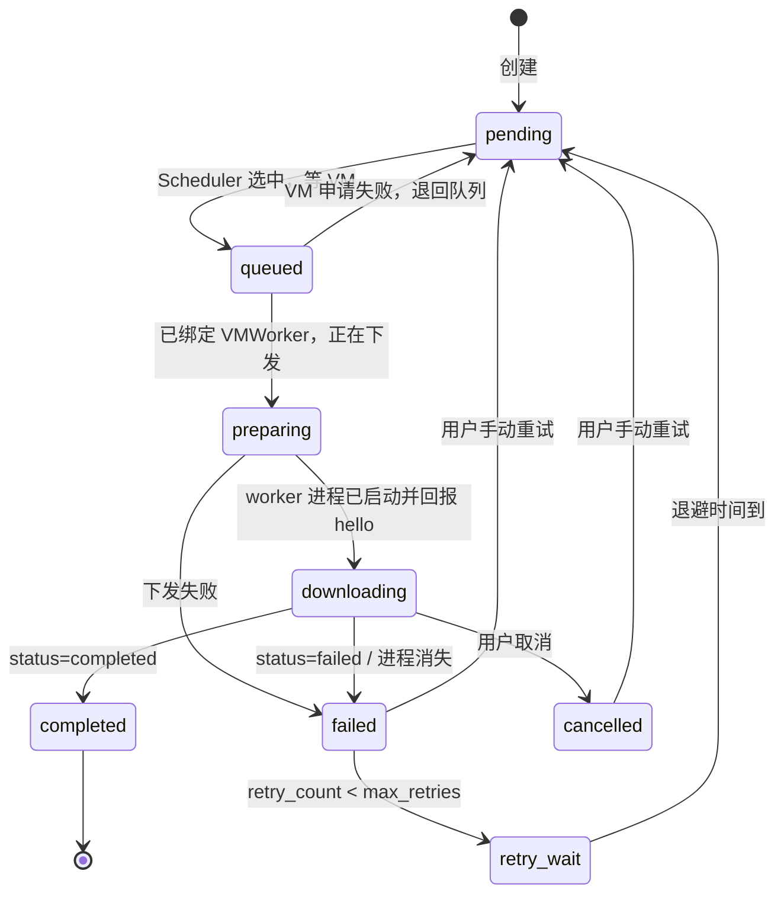
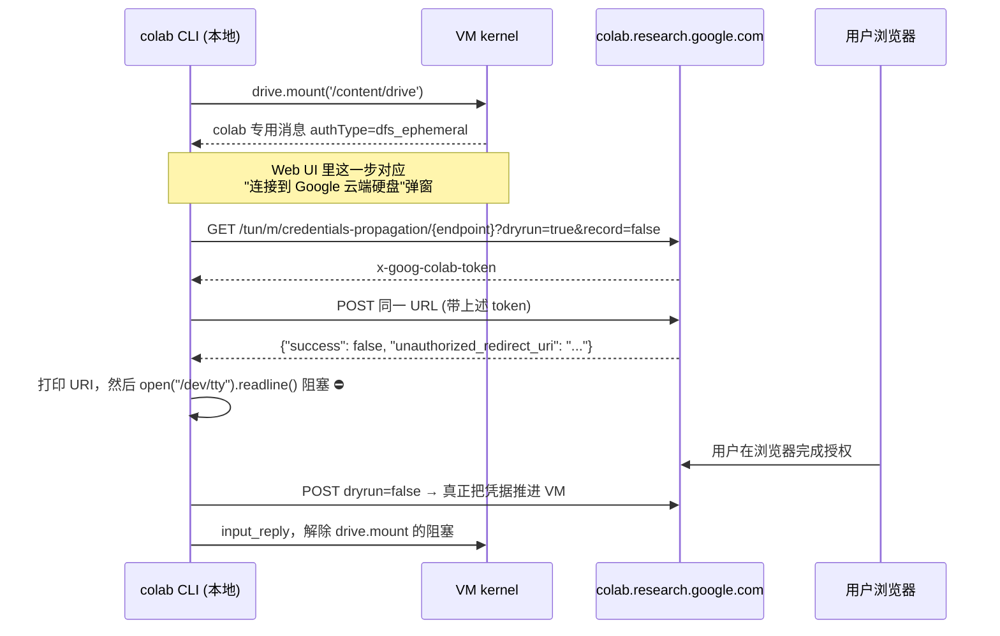
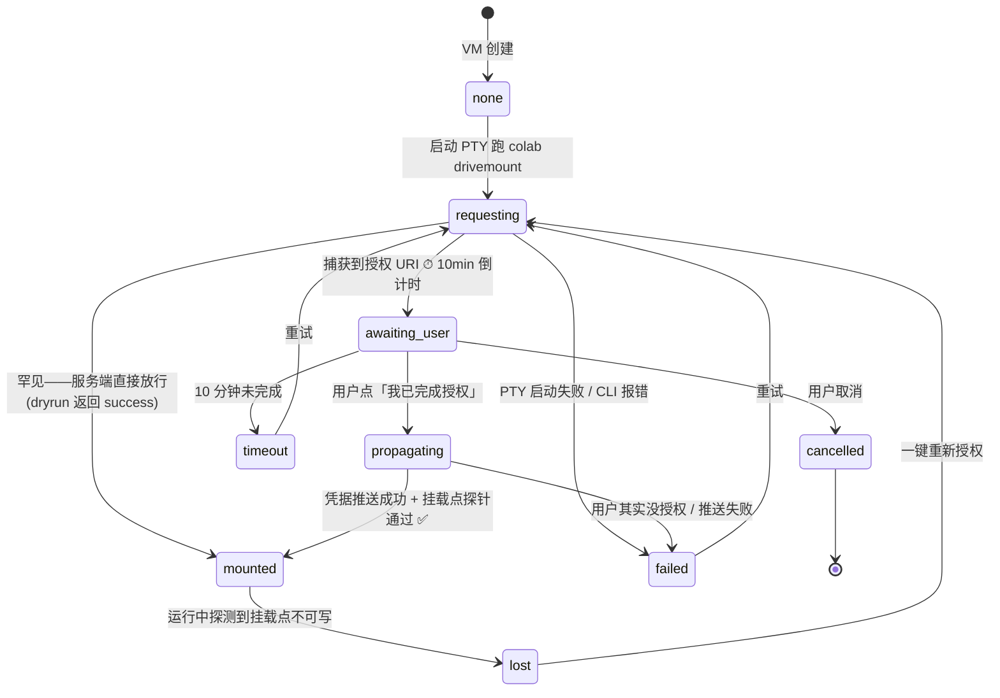
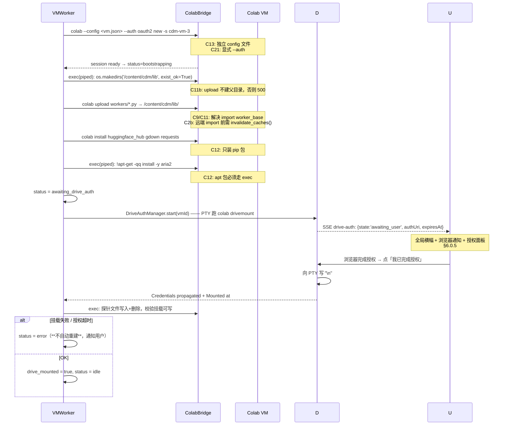
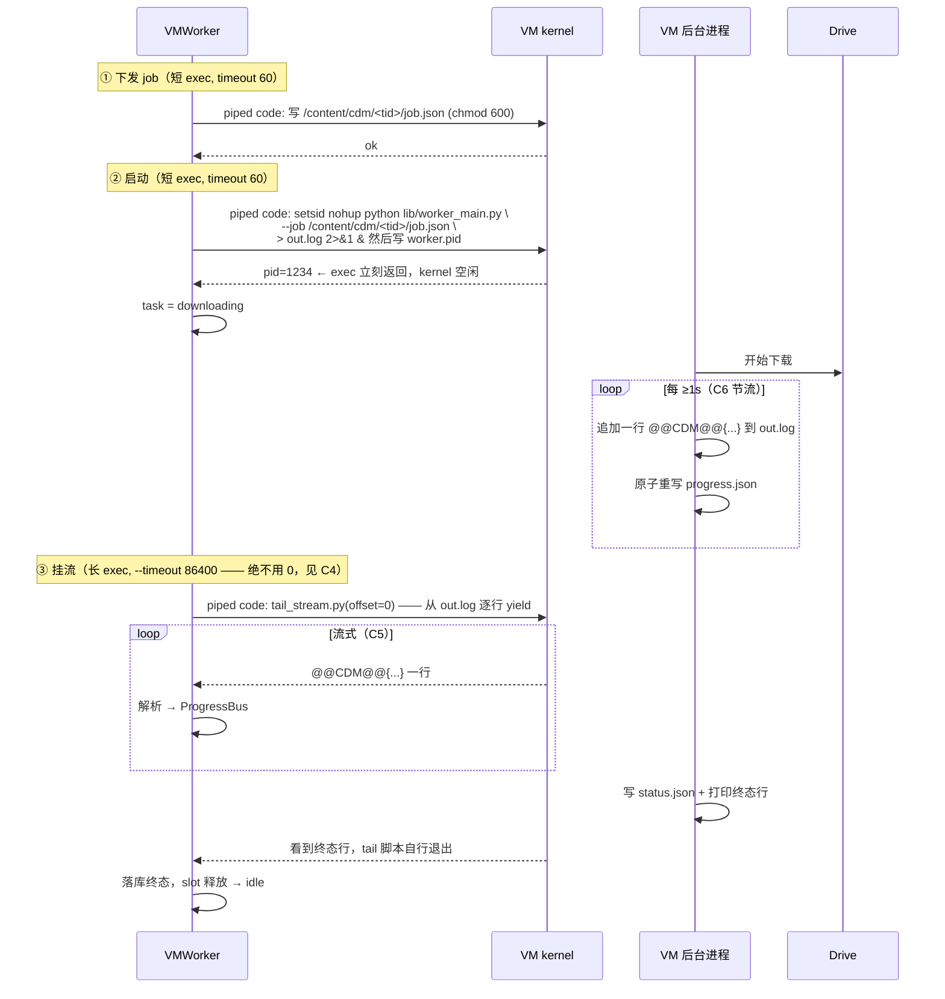
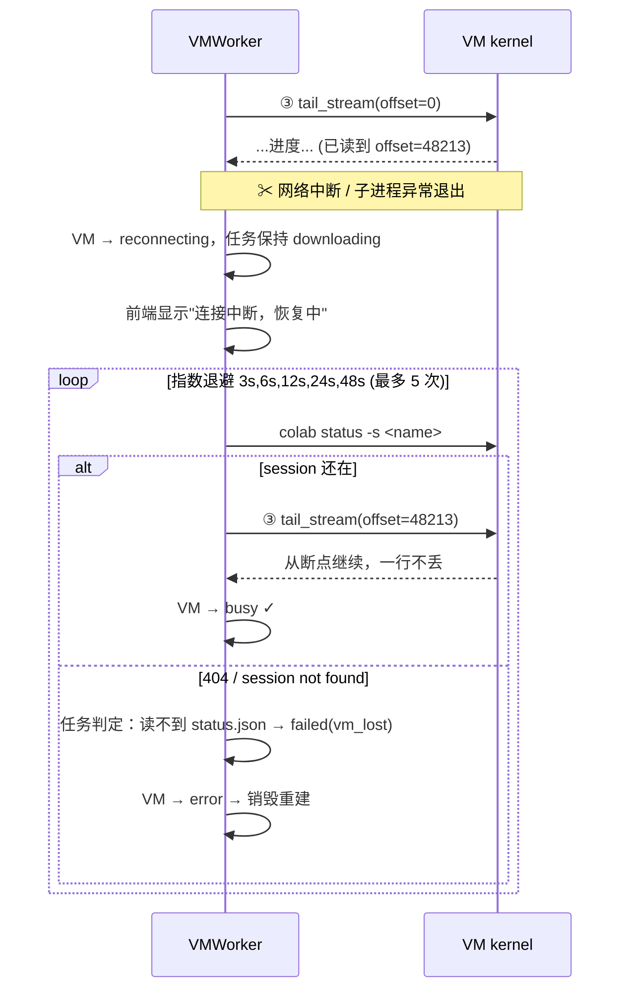
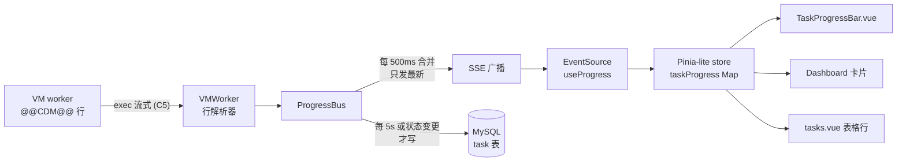
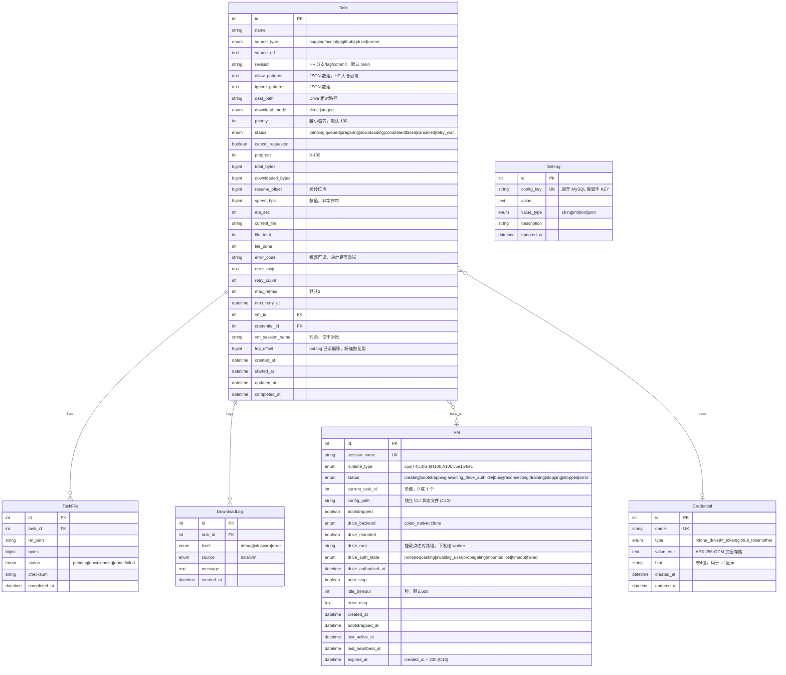

# Colab Download Manager — 详细设计文档

> 配套文档：[TASK.md](./TASK.md)（开发任务规划）
> 本文档回答「怎么做、为什么这么做」，TASK.md 回答「做什么、什么时候做」。

---

## 0. 文档约定

| 标记 | 含义 |
|:---|:---|
| ✅ **实测** | 已对本机 `google-colab-cli 0.6.0` 验证过的事实（证据见 [附录 A](#附录-a-关键实测证据)） |
| ⚠️ **待验证** | Phase 0 技术验证阶段必须跑通的假设 |
| 🔒 **风险** | 合规 / 配额 / 安全相关，需要产品决策 |

---

## 1. 设计目标与非目标

### 1.1 目标

1. **不丢任务**：本地服务重启、网络断连、CLI 进程被杀，都不能导致 VM 上正在跑的下载变成孤儿。
2. **进度可见**：页面上能看到字节级进度、速度、ETA，延迟 < 2s。
3. **VM 成本可控**：任何 VM 都不会因为程序疏忽而无限期空转。
4. **可无 VM 开发**：Mock 模式下能完成 90% 的前端与 API 开发，不烧算力。

### 1.2 非目标

- 不做多用户 / 权限体系（单人本地工具，见 [§12](#12-安全与凭据)）。
- 不做 Colab 之外的下载后端（不支持本地直下）。
- 不追求下载源的完备性，优先 `huggingface` + `http` 两种。

---

## 2. 核心约束（实测）

这一节是整个设计的地基。**所有约束均已对本机 CLI 验证。**

| # | 约束 | 证据 | 对设计的影响 |
|:--|:---|:---|:---|
| C1 | ✅ 一个 session = 一个 Jupyter kernel，同一时刻只能跑一段代码 | CLI 模型 | **1 VM = 1 Worker = 1 任务**，VM 内无并发 |
| C2 | ✅ kernel 状态跨 `exec` 持久，`exec` 退出不关 kernel | `COLAB_SKILL.md` | 可以分多次 exec 组装状态 |
| C2b | 🟠 副作用：失败的 import 会被缓存进 `sys.path_importer_cache`，后续上传文件也救不回来 | 实测 `ModuleNotFoundError` 而 `os.listdir` 可见文件 | 每次 `sys.path.insert` 后必须 `importlib.invalidate_caches()` |
| C3 | ✅ `colab exec --timeout` **默认 30 秒** | `colab exec --help` | 长任务必须显式传大正数 |
| C4 | 🔴 **`--timeout 0` 不是「永不超时」，实测只给 30 秒**（CLI bug：`0`→`None`→被当作"未指定"→回落 `REQUEST_TIMEOUT=30`） | 实测 + `execution.py:214` / `runtime.py:184` / `client.py` 签名 | **一律传显式大正数**：流式 tail 用 `--timeout 86400`，短命令 `--timeout 120`。绝不传 0 |
| C4b | ✅ 该 timeout 是**总时长预算**，不是空闲超时；持续输出也救不了 | 实测四组对照（见 spike-report §1） | `--timeout 600` + 静默 70s 可通过；`--timeout 0` + 每秒输出 75s 失败 |
| C4c | ⚠️ **客户端 exec 超时不会停止 kernel 上的执行** | 实测：超时后下载在后台跑完 | "超时 ≠ 已停止"，不可直接重试同一操作，否则重复执行 |
| C5 | ✅ `exec` 输出是**真流式**（`execute_interactive` + `output_hook`，每条 stream 消息触发一次回调） | `runtime.py:200-218` | 可以做低延迟进度 |
| C6 | ✅ 但 outputs 在客户端**无上限累积**在内存里 | `runtime.py:206` `outputs.append` | 进度行必须节流（≥1s 一条），否则长任务爆内存 |
| C7 | ✅ `colab drivemount` 在未授权时会 `open("/dev/tty").readline()` 阻塞等人 | `commands/automation.py:104-106` | 无 TTY 的子进程会抛异常 |
| C8 | ✅ **`drivemount` 的授权不可持久化：每台新 VM 都要人工在浏览器点一次** | 真实历史日志 3 次事件 + 授权 URI 参数（见 [§6.0](#60-google-drive-授权机制实测结论)） | **推翻 `google.colab.drive.mount` 方案**，改用 rclone + 自备 refresh_token |
| C8b | ✅ 授权 URI 为 `response_type=none gsession` + `prompt=consent` + `.../authorize-for-drive-credentials-ephem`，CLI 请求硬编码 `record=false` | 同上 | 该链路在设计上就是为「人在浏览器前」准备的，无持久凭据可复用 |
| C9 | ✅ `colab exec -f` 只发送**单个本地文件**内容，不上传依赖 | `commands/execution.py` | `import worker_base` 会 ImportError，必须先 `colab upload` |
| C10 | ✅ `exec -f` **不支持传参**；传参只能靠管道喂代码或 `colab run` 的 argv | `colab exec --help` | 参数化脚本用「模板渲染 + 管道」下发 |
| C11 | ✅ `colab upload {local} {remote}` 是两个必填位置参数 | `colab upload --help` | 可用于投递 worker 包 |
| C11b | 🟠 **`upload` 不会创建父目录**，目录不存在时返回 `500 Internal Server Error`（错误信息不提目录，极难定位） | 实测 | bootstrap 必须先 exec `os.makedirs(exist_ok=True)` 再 upload |
| C12 | ✅ `colab install` 只走 pip（`uv pip install --system`） | `colab install --help` | `aria2c` 等 apt 包要用 `exec` 里的 `!apt-get` |
| C13 | ✅ CLI 本地状态在 `~/.config/colab-cli/sessions.json`，并行调用会竞争；官方建议用全局 `--config <path>` 隔离 | `COLAB_SKILL.md` Safety 节 | **每台 VM 一个独立 config 文件** |
| C14 | ✅ `--auth` 的 `--help` 默认值是 `oauth2`，官方 skill 文档写的是 `adc`（文档与实现不一致） | `colab --help` vs `COLAB_SKILL.md` | **必须显式传 `--auth`**，不依赖默认 |
| C15 | ✅ 支持的加速器：GPU `T4/L4/G4/H100/A100`，TPU `v5e1/v6e1`；未识别的 `--gpu` 会**静默回退到 A100** | `colab new --help` + skill | 枚举要对齐，且要校验入参 |
| C16 | ✅ 无人回收 VM，只有 24h keep-alive 上限 | `COLAB_SKILL.md` | 必须自己做空闲回收 + `expires_at` 硬上限 |
| C17 | ✅ `colab` 每条命令都是一次性进程：认证 → 干一件事 → 退出 | `COLAB_SKILL.md` | 每次轮询都有 1-3s 认证开销，**不能高频短轮询** |
| C18 | 🔒 Colab ToS 明确禁止 torrent / P2P 文件共享 | Colab FAQ | torrent 源默认关闭，见 [§13](#13-配额成本与合规) |
| C19 | 🔒 Google Drive 免费配额 15GB；每日上传上限 750GB | Google 文档 | 下载前必须预检剩余空间 |
| C20 | 🔒 Colab 并发 session 数受订阅档位限制（免费档常见 1-2） | Colab 文档 | `colab new` 会失败，需优雅降级 |
| C21 | ✅ `--auth` 默认值实测为 `oauth2`（官方 skill 文档写的 `adc` 是错的） | `cli.py:78` `= AuthProvider.OAUTH2` | 仍应显式传参，但基线按 oauth2 设计 |
| C22 | ✅ oauth2 模式的 token 含 6 个 scope（含 `drive.file`）且带 refresh_token，自动续期 | `~/.config/colab-cli/token.json` | CLI 自身认证是长期有效的，**与 C8 的 Drive 授权是两回事** |
| C23 | ⚠️ `sessions.json` 中明文存放 VM 的 JWT token 与 endpoint | 本机实测 | 该文件按机密对待，权限 600，不进日志、不进备份 |
| C24 | ✅ PTY 方案成立：`script -qec` 即可，**无需 node-pty 原生编译**；纯管道必失败于 `/dev/tty` | 实测对照实验 | DriveAuthManager 用 `script -qec` 实现 |
| C25 | ✅ 授权链路实测耗时：捕获 URI **5.8s**，确认后 **11s** 才 `Mounted at` | 实测 | `propagating` 状态不能瞬间跳过，UI 要显示 |
| C26 | ✅ 授权 URI 实测 **1415 字符**，`state` 内含 VM endpoint | 实测 | UI 折叠 + 复制按钮；二维码需大尺寸高容错 |
| C27 | 🔴 **吞吐实测远低于宣称值**：单连接 30 MB/s，`aria2c -x8` **174 MB/s**（最优），`hf_transfer` 124.6 MB/s（→Drive），默认 `hf_hub_download` 仅 93.4 MB/s（→Drive） | 实测 2.88GB 文件 | HTTP 用 `aria2c -x8`；HF 启用 `hf_transfer`；**「39GB ~2 分钟」改为「约 4-6 分钟」** |
| C28 | ✅ Drive FUSE 写入损耗：默认路径 18%，`hf_transfer` 仅 5% | 实测 | 默认启用 `hf_transfer` |
| C29 | ✅ `shutil.disk_usage(drive_root)` 可读到真实 Drive 配额 | 实测 225.83GB/195.58GB | 下载前预检方案可行 |
| C30 | ✅ `restart-kernel` **不会**杀死 `start_new_session=True` 的后台进程 | 实测 | §6.5 取消流程成立 |
| C31 | ✅ `colab new`(CPU) **15.9s**；`pip huggingface_hub` 4.6s；`apt aria2` ~15s | 实测 | bootstrap 预算回填 |

---

## 3. 总体架构

### 3.1 架构图



### 3.2 一 VM 一 Worker 模型（核心设计）

> **这是相对原方案最重要的一处改动。**

原方案给 `VM` 表设计了 `queue_size` / `max_queue=5`，即「VM 内部排队」。但由 **C1** 可知，一个 Colab session 只有一个 kernel，同一时刻只能执行一段代码。VM 内排队在物理上不存在，强行实现只会导致两个 `colab exec` 并发打同一个 kernel 而互相污染。

**新模型：**

```
┌─────────────────────────────────────────────────────────────┐
│  中心队列 (MySQL: task.status = 'pending' ORDER BY priority) │
└──────────────────────────┬──────────────────────────────────┘
                           │  TaskScheduler 只做一件事：
                           │  把 1 个 pending 任务派给 1 个 idle VMWorker
        ┌──────────────────┼──────────────────┐
        ▼                  ▼                  ▼
   ┌─────────┐        ┌─────────┐        ┌─────────┐
   │VMWorker1│        │VMWorker2│        │VMWorker3│   ← 单槽，有且仅有
   │ slot: T7│        │ slot: - │        │ slot:T12│      0 或 1 个任务
   └────┬────┘        └────┬────┘        └────┬────┘
        │ 独占            │                  │
        ▼                  ▼                  ▼
     VM-1 kernel       VM-2 kernel        VM-3 kernel
     + 1 个后台         (idle)            + 1 个后台
       下载进程                              下载进程
```

**职责切分：**

| 组件 | 职责 | 明确**不**负责 |
|:---|:---|:---|
| `TaskScheduler` | 选任务（优先级/创建时间）、选空闲 Worker、按需扩容 VM、退避重试的定时唤醒 | 不碰 CLI、不解析进度 |
| `VMWorkerPool` | 持有全部 VMWorker 实例、增删、暴露 `acquireIdle()` | 不做业务决策 |
| `VMWorker` | **一台 VM 的全部生命周期**：创建、bootstrap、挂载 Drive、跑任务、流式收进度、断连重连、取消、空闲回收、停止 | 不选任务（由 Scheduler 喂） |
| `ColabBridge` | 无状态地把 `colab xxx` 拼成子进程并处理 stdout/stderr/exit code | 不知道任务和 VM 的概念 |
| `ProgressBus` | 收进度事件 → 节流 → 写 DB（低频）+ 广播 SSE（高频） | 不解析行协议 |
| `Reconciler` | 启动时对账、周期性空闲回收、`expires_at` 强制停机 | 不派发任务 |

**这个模型带来的好处：**

1. **没有跨 VM 的锁**。每个 VMWorker 是一个独立的 actor（`async` 串行循环），VM 上的一切状态变更都只由它自己发起，天然无竞态。
2. **失败爆炸半径 = 1 台 VM**。某台 VM 挂了只影响它自己那一个任务，Worker 自杀重建即可。
3. **`--config` 隔离天然对齐**（C13）：每个 VMWorker 拥有独立的 `~/.config/colab-cli-cdm/vm-<id>.json`，并行调 CLI 不会踩状态文件。
4. **限流点唯一**：并发度 = VMWorker 数量，直接对应 Colab 的并发 session 限制（C20）。

**代价（必须接受）：**

- 一台 VM 同时只能跑一个任务，下载 3 个文件要开 3 台 VM。
- VM bootstrap 有固定成本（~30-60s），短任务不划算 → 用 **VM 复用 + 空闲驻留**（`idle_timeout` 默认 600s）来摊薄。

---

## 4. VMWorker 状态机



**关键规则：**

- `busy → reconnecting` 时**不改任务状态**。VM 上的进程还在跑，任务仍是 `downloading`，只是进度暂时不更新。前端显示"连接中断，正在恢复"。
- `expires_at = created_at + 23h`（留 1h 余量，对抗 C16 的 24h 硬上限）。**提前 1h 提醒**用户，到点强制 `draining`。
- `error` 状态的 VM 不复用。但**自动重建默认关闭**（§6.0.5）—— 重建出来的 VM 照样要人工授权，自动重建只是把阻塞点换个位置，不如直接通知用户。
- `awaiting_drive_auth` 的 VM **不接受任务派发**，Scheduler 必须跳过；其上等待的任务停在 `queued`，且列表页要显示「等待 VM 授权」而非干等。

---

## 5. Task 状态机



**状态含义（必须严格遵守，前端据此渲染）：**

| 状态 | 含义 | VM 占用 | 可取消 |
|:---|:---|:---|:---|
| `pending` | 在中心队列里，未分配 | 否 | 是（直接改状态） |
| `queued` | Scheduler 已选中，正在等 VM 就绪 | 预留 | 是 |
| `preparing` | 正在上传 job、启动进程 | 是 | 是 |
| `downloading` | VM 上进程在跑 | 是 | 是（需杀进程） |
| `retry_wait` | 失败等退避，`next_retry_at` 有值 | 否 | 是 |
| `completed` / `failed` / `cancelled` | 终态 | 否 | — |

---

## 6. 执行链路详细设计

### 6.0 Google Drive 授权机制（实测结论）

> **这一节推翻了本项目最初的方案假设，是整个设计里最重要的一次修正。**

#### 6.0.1 `colab drivemount` 究竟做了什么

`drivemount` 命令本身极其简单 —— 只是在 kernel 上执行两行代码：

```python
# colab_cli/commands/automation.py:207
code = f"from google.colab import drive\ndrive.mount('{path}')"
run_automation(name, "drivemount", code, allow_stdin=True, timeout=600)
```

真正的机制在 CLI 注册的 `drivefs_hook` 上：



#### 6.0.2 决定性证据：授权**不可持久化**

本机 `~/.config/colab-cli/history/comfyui-h3.jsonl` 的真实事件序列：

```
2026-08-09T01:11:52  drive_auth_needed    (session A) → 用户放弃，01:13:25 session 终止
2026-08-09T01:13:58  drive_auth_needed    (session B)
2026-08-09T01:14:09  drive_auth_success   ← 授权成功
        │  session B 持续存活到 02:28:44
2026-08-09T02:32:53  drive_auth_needed    (session C，新建)   ⚠️ 又要授权
2026-08-09T02:34:03  drive_auth_success
```

**三次新建 session，三次都要人工点。没有任何一次"新 session 免授权"的反例。**

看授权 URI 的参数就知道这是设计使然：

| 参数 | 值 | 含义 |
|:---|:---|:---|
| `response_type` | `none gsession` | **不返回 code/token**。授权结果绑定在浏览器的 Google 登录会话（cookie）上，客户端拿不到任何可持久化的凭据 |
| `redirect_uri` | `.../authorize-for-drive-credentials-**ephem**` | ephemeral = 短期凭据 |
| `prompt` | `consent` | 强制每次显示同意屏，禁用"已授权则静默通过" |
| `scope` | `.../auth/drive` + drive.activity + drive.photos + ... | 完整 Drive 读写（注意：不是 CLI 自身持有的 `drive.file`） |
| CLI 请求参数 | `record=false`（硬编码） | 明确要求服务端**不记录**这次授权 |

**结论：这条链路是为「人坐在浏览器前」的交互式场景设计的，不存在可复用的持久凭据。**

> ⚠️ 注意区分两种完全不同的认证，别混淆：
> - **CLI 自身的认证**（`~/.config/colab-cli/token.json`）—— 6 个 scope、带 refresh_token、长期有效、自动续期（C22）。这一层**没有问题**。
> - **VM 的 Drive 凭据传播**（本节）—— 短期、每 VM 一次、必须人工。这一层**是问题所在**。

#### 6.0.3 对原方案的杀伤

| 场景 | 用 `drivemount` 的后果 |
|:---|:---|
| VM 池自动扩容 | 每扩一台要人工点一次 ❌ |
| `error` VM 自动销毁重建 | 要人工 ❌ |
| 23h 到期轮换 VM | 要人工 ❌ |
| 夜间挂 10 个任务无人值守 | 第一台 VM 出问题后全线阻塞 ❌ |

**"无人值守批量下载"这个核心价值直接不成立。** 因此本项目**不使用** `google.colab.drive.mount`。

#### 6.0.4 方案选型

| 方案 | 人工成本 | 长期凭据落到 VM | 磁盘上限 | 结论 |
|:---|:---|:---|:---|:---|
| **A. `colab drivemount` + 页面授权引导** | **每台 VM 一次**（~30 秒） | ❌ 不需要 | 无 | ⭐ **采用，默认** |
| B. rclone mount + 自备 refresh_token | 全系统一次 | ⚠️ 需要 | 无 | 可选，追求无人值守时启用（§6.0.7） |
| C. Drive API resumable 直传 | 全系统一次 | ⚠️ 需要 | 无 | 不实现，收益不及 B |
| D. 服务账号 | 零 | — | — | ❌ 服务账号无个人 Drive 配额，除非有 Workspace 共享盘 |

**选 A 的理由（这是产品决策，用户已确认接受）：**

1. 每台 VM 授权一次的成本可接受 —— 点一个链接、点一次同意，约 30 秒，且 VM 会长期复用。
2. **安全性反而更好**：不需要把一个拥有完整 Drive 读写权限的长期 refresh_token 写进 Colab VM 的文件系统（那是方案 B 的固有风险）。ephemeral 凭据短期有效，走的是 Colab 官方支持路径。
3. 用户无需自建 OAuth client、无需管理 refresh_token 轮转。

**接受的代价：**

- VM 自动扩容、自动重建、23h 到期轮换时需要人工介入一次。
- **完全无人值守（如夜间批量下载）不成立**，除非提前把 VM 开好并授权。
- 因此设计上必须把「叫人回来」这件事做到位 —— 见 §6.0.5 的通知机制。

#### 6.0.5 授权引导：完整设计

> 这是 `drive_backend = colab_native`（默认）下的核心交互。设计目标：**用户绝不会"不知道系统在等他"，且知道后一键即可完成。**

##### 授权状态机（每台 VM 一份）



##### 后端机制

`colab drivemount` 在等待期间是**一个活着的、阻塞在 `/dev/tty` 上的子进程**。后端必须持有它：

```
DriveAuthManager（Nitro 单例）
  registry: Map<vmId, {
      pty,               // node-pty 句柄（备选：script -qec 包一层）
      authUri,           // 从输出里正则提取
      state,             // 上述状态机
      startedAt,
      expiresAt,         // startedAt + 600s（CLI 的 INTERACTIVE_AUTOMATION_TIMEOUT_SEC）
      outputBuffer       // 全量输出留档，排障用
  }>
```

**关键实现点：**

| 点 | 做法 |
|:---|:---|
| 必须用真 PTY | `/dev/tty` 是直接打开 tty 设备，**不是读 stdin**，管道喂不进去。用 `node-pty`；若编译困难，退化为 `script -qec "colab drivemount -s <name>" /dev/null` |
| 提取授权 URI | 匹配 `REQUIRED: Google Drive Authorization needed.` 之后的 `https://accounts.google.com/...`，正则 `/(https:\/\/accounts\.google\.com\/o\/oauth2\/\S+)/` |
| 确认动作 | 用户点按钮 → 向 PTY 写入 `"\n"`（对应 CLI 的 `tty.readline()`） |
| 成功判定 | 等待输出出现 `Credentials propagated` **且** `Mounted at`；**再补一次挂载点写探针校验**，两者都过才算 `mounted` |
| 超时 | CLI 侧 600s 硬超时。前端显示倒计时；到期后自动清理 PTY，状态转 `timeout`，提供「重试」 |
| 服务重启 | PTY 随进程死亡。Reconciler 启动时把所有 `awaiting_drive_auth`/`requesting` 的 VM 重置为可重试，并在页面提示「授权会话已失效，请重新发起」 |
| 幂等 | 同一 VM 重复调 `auth-start` 时，若已有活跃 PTY 则直接返回现有 URI，不重复起进程 |
| 输出留档 | 全量 PTY 输出写 `logs/colab/<vmId>/drive-auth-<ts>.log`，排障唯一线索 |

##### 页面呈现（用户要求的核心）

**① 全局横幅** —— `layouts/default.vue`，只要存在任一 `awaiting_user` 的 VM 就常驻，任何页面都能看到：

```
┌────────────────────────────────────────────────────────────────┐
│ ⚠  1 台 VM 正在等待 Google Drive 授权   剩余 8:42   [去授权 →] │
└────────────────────────────────────────────────────────────────┘
```

**② 授权面板** `DriveAuthPanel.vue` —— 横幅或 VM 卡片点开后的弹窗：

```
┌─ Google Drive 授权 ── VM: cdm-vm-3 ─────────────────────┐
│                                                          │
│  ①  [ 打开授权页面 ↗ ]        ← 新标签页打开授权 URI      │
│      https://accounts.google.com/o/oauth2/v2/auth?...    │
│      [复制链接]   [显示二维码]  ← 二维码方便用手机点      │
│                                                          │
│  ②  在打开的页面中选择账号并同意 Drive 访问权限          │
│                                                          │
│  ③  [ 我已完成授权 ]          ← 向 PTY 写回车            │
│                                                          │
│  状态：⏳ 等待授权中…              剩余时间 08:42        │
│  [取消]                                    [重新发起]    │
└──────────────────────────────────────────────────────────┘
```

- 状态行随 SSE 实时变化：`⏳ 等待授权中` → `🔄 正在推送凭据…` → `✅ 已挂载 /content/drive/MyDrive`。
- 失败时直接展示 CLI 的原始错误行，不做二次包装（排障效率优先）。

**③ VM 卡片状态徽标** `vms.vue`：

| VM 状态 | 徽标 | 操作按钮 |
|:---|:---|:---|
| `awaiting_drive_auth` | 🟠 需要授权 | **[授权]**（主按钮，高亮） |
| `bootstrapping` | 🔵 准备中… | — |
| `idle` | 🟢 空闲 · Drive 已挂载 | [停止] |
| `busy` | 🔵 下载中 | [停止] |
| Drive `lost` | 🔴 Drive 挂载失效 | **[重新授权]** |

**④ 设置页授权总览** `settings.vue`：列出全部 VM 的 Drive 授权状态、授权时间、VM 到期时间，一处纵览。

**⑤ 主动通知（关键 —— 用户可能不在页面上）**：

| 手段 | 说明 |
|:---|:---|
| 浏览器通知 | `Notification API`，首次使用时请求权限。标题「Colab Download Manager 需要授权」，点击直接聚焦到授权面板 |
| 页面标题闪烁 | `document.title` 交替为 `⚠ 需要授权`，切到别的标签页也能看见 |
| 提示音 | 可在设置中关闭，默认开 |
| 任务卡住原因 | 任务停在 `queued` 时，列表页该行直接显示「等待 VM 授权」而不是干等，并给出跳转链接 |

##### 调度策略随之调整

既然 VM 的创建成本从「算力」变成了「人的注意力」，调度必须相应保守：

| 项 | 初版 | 现在 | 理由 |
|:---|:---|:---|:---|
| `idle_timeout` 默认 | 600s | **3600s** | 授权过的 VM 尽量留着，别让用户反复授权 |
| VM `error` 后自动重建 | 开 | **关（默认）** | 重建出来的 VM 照样要人工授权，自动重建只是把阻塞点换个位置；改为标记错误 + 通知用户 |
| 自动扩容 | 无限制 | 一次只创建 **1 台**待授权 VM | 避免同时弹出多个授权请求 |
| `expires_at` 临近 | 到点才处理 | **提前 1h 提醒**「VM 即将到期，建议现在开新 VM 并授权」 | 让用户在方便的时候处理，而不是被半夜叫醒 |
| 新增：预热操作 | — | VM 页提供「开 N 台并授权」，逐台引导 | 睡前一次性开好 3 台，夜里就能无人值守跑完队列 |

> 💡 **无人值守的正确姿势**：睡前用「预热」把 2-3 台 VM 开好并授权 → 提交 20 个任务 → 队列在这几台 VM 上串行跑完。只要不触发 VM 重建或到期，全程无需人工。这是方案 A 下达成无人值守的现实路径。

#### 6.0.6 运行中挂载失效的处理

ephemeral 凭据的确切 TTL **未知**（Phase 0 的 0.2d 负责实测）。若长下载途中 Drive 挂载失效：

```
1. Worker 每 60s 往 drive_root 写一个探针文件再删除
2. 探测失败 → 立即写 status.json:
     {"status":"failed","error_code":"DRIVE_MOUNT_LOST"} 并退出
3. VMWorker 收到该 error_code 的特殊处理（不同于普通失败）：
     - 任务 → retry_wait（不消耗 retry_count，因为这不是任务本身的错）
     - VM   → awaiting_drive_auth，弹授权
4. 用户重新授权 → VM 回 idle → 任务凭 resume_offset 在同一台 VM 上续传
```

**关键：不能把它当成普通失败。** 否则一次凭据过期会让整个队列的任务全部耗尽重试次数。

#### 6.0.7 可选方案 B：rclone 无人值守模式

给确实需要「开机即跑、永不打扰」的场景保留，`setting.drive_backend = 'rclone'`：

```bash
rclone authorize "drive"      # 本地跑一次，输出含 refresh_token 的 JSON
```
设置页粘贴 → 加密存入 `Credential(type='rclone_drive')`。每台 VM bootstrap 时自动：

```
1. 下载 rclone 静态二进制到 /content/cdm/bin/rclone
2. 渲染 rclone.conf（token 内嵌，chmod 600，用 rclone obscure 处理）
3. rclone mount cdmdrive: /content/drive_rc --daemon --vfs-cache-mode writes
4. 写探针文件校验
```

> 🔑 **启用前必须知道**：refresh_token 拥有完整 Drive 读写权且会被写到 Colab VM 上。必须 `chmod 600`、任务结束即删、绝不进日志。介意的话建议单开一个专用 Google 账号。**这正是默认不启用它的原因。**

排期上放到 Phase 8（扩展能力），不阻塞主线。

### 6.1 VM Bootstrap（VMWorker: creating → idle）



（图中 `D` = DriveAuthManager，`U` = 用户浏览器）

**耗时预算（Phase 0 实测回填）**：`colab new` **15.9s**，`makedirs+upload` ~5s，`pip huggingface_hub+hf_transfer` **4.6s**，`apt aria2` ~15s，**捕获授权 URI 5.8s + 人工授权 + 确认后挂载 11s**，挂载探针 ~1s。机器耗时合计 **~55s**，加上人工授权时间。

> 这笔成本正是 `idle_timeout` 默认设为 **3600s** 的原因 —— VM 授权一次就尽量留着复用，别让用户反复授权。

### 6.2 任务下发：两段式 exec

这是**替代原方案「一个 exec 从头挂到尾」的核心改动**。原方案的致命问题：本地进程要全程持有 WebSocket，网络抖动 / Nitro 热更新 / 服务重启 → VM 上下载还在跑，但服务端永远收不到结果，任务永久卡在 `downloading`。

**新方案：VM 上的进程与本地连接彻底解耦。**



**为什么是两段：**

- 第 ① ② 段是**短 exec**，秒级返回，kernel 随即空闲。
- 第 ③ 段的 `tail` 脚本只是**读文件**，它死了不影响下载进程（进程是 `setsid nohup` 脱离的）。
- 任何时候重连，只要带上 `offset` 重跑 ③ 段，就能从断点续读，一行不丢。

**VM 上的任务目录结构（约定）：**

```
/content/cdm/
├── lib/                        # bootstrap 时 upload 一次，全任务共享
│   ├── worker_base.py
│   ├── worker_main.py          # 入口，读 job.json 分发
│   ├── src_huggingface.py
│   ├── src_http.py
│   ├── src_github.py
│   ├── src_gdrive.py
│   └── src_torrent.py
└── <taskId>/
    ├── job.json                # 任务描述（含凭据，chmod 600）
    ├── worker.pid              # 后台进程 pid
    ├── out.log                 # append-only 行协议流（③ 段的数据源）
    ├── progress.json           # 最新进度快照，原子写（断连恢复用）
    └── status.json             # 终态，幂等判定的唯一依据
```

**参数如何传给脚本（对应 C10）：**

`colab exec -f` 不支持传参。所以 ColabBridge 提供 `execTemplate(vm, templateName, vars)`：读取本地 `.py.tpl`，用 `vars` 做安全替换（值一律 `json.dumps` 序列化后内嵌，杜绝注入），把渲染结果**通过管道喂给 `colab exec -s <name>`**。

`worker_main.py` 本身是 upload 上去的完整模块，参数走 `job.json` 文件，不走命令行。

### 6.3 断连恢复



**恢复时的真相来源顺序**（幂等的关键）：

1. `status.json` 存在 → 任务已终结，直接采用其中的终态（**即使我们从没收到过那条流式消息**）。
2. 否则 `worker.pid` 对应进程还活着 → 任务仍在跑，继续 tail。
3. 否则 → 进程死了且没写终态 → `failed`，`error_msg = "worker process vanished"`。

### 6.4 服务重启后的对账（Reconciler）

Nitro 启动时执行一次，**先于** Scheduler 启动：

```
1. colab sessions                        → 拿到服务端真实存活的 session 列表
2. 与 DB 的 vm 表做双向 diff：
   - DB 有 / 远端无  → VM 标记 stopped，其上任务走「6.3 真相来源」判定
   - DB 无 / 远端有  → 孤儿 VM。按 setting.orphan_policy 处理：
                       adopt（纳管，默认）| stop（直接停）| ignore
   - 两边都有        → 重建 VMWorker 实例，若其上有 downloading 任务则
                       立刻走 6.3 恢复流程（用 progress.json 的 offset）
3. 所有 status ∈ {queued, preparing} 的任务无条件退回 pending（这两个状态不可恢复）
4. 完成后才允许 TaskScheduler 开始派发
```

### 6.5 取消

取消要处理「kernel 正被 ③ 段的 tail 占着」这个麻烦（C1）：

```
1. 立即写 task.cancel_requested = true（前端马上变灰，体验优先）
2. 若任务在 pending / retry_wait  → 直接置 cancelled，结束
3. 若任务在 downloading：
   a. colab restart-kernel -s <name>   ← 打断 tail 脚本，但保留 VM
      （setsid nohup 的下载进程不受 kernel 重启影响，仍在跑）
   b. 短 exec: kill -TERM $(cat worker.pid)，等 5s
   c. 仍活着 → kill -9
   d. 短 exec: 写 status.json = {"status":"cancelled"}
   e. 清理 /content/cdm/<tid>/ 与半成品文件
   f. VM → idle
```

### 6.6 重试与退避

```
next_retry_at = now + min(30 * 2^retry_count, 1800) 秒   （30s → 30min 封顶）
```

- `retry_count >= max_retries` → 终态 `failed`，不再自动重试。
- **不重试的错误类型**（写进 `error_code`，直接终态失败）：`AUTH_REQUIRED`、`SOURCE_NOT_FOUND`(404)、`DRIVE_QUOTA_EXCEEDED`、`INVALID_URL`、`CANCELLED`。重试这些纯属浪费算力。
- 重试时**换一台 VM**（原 VM 可能就是坏的）。
- HTTP / HF 类型重试时携带 `resume_offset`，走断点续传（见下）。

### 6.7 Drive 后端抽象

由于存在两种 Drive 接入方式（§6.0.4 的 rclone 与 §6.0.5 的保底手动授权），Worker 代码**不应该知道**自己写的是哪一种。抽象成一个设置项 + 一个挂载点变量：

| `setting.drive_backend` | 挂载点 | 人工成本 | 长期凭据落 VM | 排期 |
|:---|:---|:---|:---|:---|
| `colab_native`（**默认**） | `/content/drive/MyDrive/` | 每台 VM 一次（~30s） | ❌ 不需要 | Phase 3 |
| `rclone` | `/content/drive_rc/` | 全系统一次 | ⚠️ 需要 | Phase 8（可选） |

- `job.json` 里下发 `drive_root` 绝对路径，Worker 只认这个变量。
- `dest_path` 在 DB 里始终存**相对路径**（如 `downloads/MiniMax-H3`），拼接在 VMWorker 侧完成 —— 这样切换 backend 不需要迁移历史数据。
- 路径穿越校验对两种 backend 一视同仁：规范化后必须落在 `drive_root` 之下。

### 6.8 断点续传

| 源类型 | 续传机制 | 前提 |
|:---|:---|:---|
| `http` | `aria2c -x8 -s8 -k10M --continue`（实测 174 MB/s，单连接仅 30 MB/s） | 目标文件必须在 Drive 挂载点上（VM 重建后 `/content` 会丢） |
| `huggingface` | `resume_download` + `local_dir` 指向 Drive；**必须设 `HF_HUB_ENABLE_HF_TRANSFER=1`**（124.6 vs 93.4 MB/s）与 `HF_HUB_DISABLE_IMPLICIT_TOKEN=1`（抑制 Colab vault 噪声） | 同上 |
| `github` | 同 `http` | 同上 |
| `gdrive` | `gdown` 不支持可靠续传 → **不支持**，失败即整体重来 | — |
| `torrent` | aria2c 原生支持（`.aria2` 控制文件在 Drive 上） | 🔒 默认关闭 |

> **设计张力（原方案 Phase 7.3 未处理）**：断点续传要求「直接下载进 Drive 挂载点」，而 Drive FUSE 写入比本地磁盘慢且偶发 I/O 错误。
> **决策**：默认 `download_mode = direct`（直写 Drive，支持续传）。设置项提供 `staged` 模式（先落 `/content` 再 `cp` 到 Drive，更快但不支持跨 VM 续传），由用户按文件大小自行选择。

---

## 7. 进度上报协议 v2

### 7.1 相比 v1 的改动

| 问题（v1） | v2 解法 |
|:---|:---|
| 纯 JSON 行，但 `huggingface_hub` / `aria2c` / tqdm 会往 stdout 喷自己的输出，解析必崩 | 加**魔法前缀** `@@CDM@@`，非该前缀的行一律当普通日志，永不进解析器 |
| 没有 `taskId`，多任务/多文件无法归属 | 每行必带 `tid` |
| 没有序号，断连重连无法去重 | 每行带单调递增 `seq` |
| 没有心跳，长时间无输出无法区分"慢"和"死" | 新增 `heartbeat` 类型，≥30s 一条 |
| 没规定频率，500MB/s 逐块打印会淹掉 SSE（且触发 C6 内存问题） | **强制节流：progress 类型 ≥1s 一条** |
| 没有版本号 | 带 `v` 字段 |

### 7.2 行格式

```
@@CDM@@{"v":1,"tid":42,"seq":137,"ts":1754700000.123,"type":"progress",...}
```

- 一行一个 JSON，`flush=True`。
- 🔴 **不能假设 `@@CDM@@` 在行首。** 实测抓到过这样的行：

  ```
  [tqdm-noise] 70% |####      | 35/60 [00:05<00:00]@@CDM@@{"v":1,"tid":42,...}
  ```

  `\r` 风格的进度输出不带换行，会把魔法前缀挤到行中间。原先写的 `line.startsWith(MAGIC)` **会直接漏掉这一行**。

- 正确的解析规则：**扫描行内所有出现位置**

  ```ts
  // ❌ 错误
  if (line.startsWith(MAGIC)) parse(line.slice(MAGIC.length))

  // ✅ 正确
  for (const m of line.matchAll(/@@CDM@@(\{.*?\})(?=\s*$|@@CDM@@)/g)) tryParse(m[1])
  ```

  实测该正则对全量 63 条消息校验，零缺失。
- 未匹配到魔法前缀的内容 → 原样作为 `DownloadLog(level=info, source=vm)` 落库（限流后）。

### 7.3 消息类型

```python
# ① hello —— 进程启动，preparing → downloading 的依据
{"type":"hello","pid":1234,"source_type":"huggingface","files_planned":7}

# ② progress —— 节流 ≥1s 一条
{"type":"progress",
 "downloaded":1073741824,      # 本任务累计已下载字节
 "total":10737418240,          # 总字节，未知时为 null
 "speed_bps":268697600,        # 瞬时速度，字节/秒（数值，不是字符串！前端负责格式化）
 "eta_sec":38,                 # 剩余秒数，未知时 null
 "file":"model.safetensors",   # 当前文件
 "file_index":3,"file_total":7}

# ③ file —— 单个文件完成（多文件任务用）
{"type":"file","file":"config.json","bytes":1024,"status":"done"}

# ④ log
{"type":"log","level":"info","message":"开始下载 model.safetensors"}

# ⑤ heartbeat —— ≥30s 一条，证明进程活着
{"type":"heartbeat","downloaded":1073741824}

# ⑥ status —— 终态，与 status.json 内容一致
{"type":"status","status":"completed","bytes":10737418240,"duration_sec":142,
 "dest":"/content/drive_rc/downloads/MiniMax-H3"}
{"type":"status","status":"failed","error_code":"DRIVE_QUOTA_EXCEEDED",
 "error":"Drive 剩余空间不足：需要 39.2GB，可用 8.1GB"}
```

> **`speed` 字段类型变更**：v1 是 `"256.3 MB/s"` 字符串。v2 改为 `speed_bps` 数值。理由：字符串没法做图表、排序、聚合，格式化是前端的事。

### 7.4 落盘约定

Worker 每次发 `progress` 时，除了打印到 stdout，还要**原子重写** `progress.json`（写临时文件 + `os.replace`）。终态时写 `status.json`。这两个文件是断连恢复的真相来源（§6.3）。

---

## 8. 进度展示链路

> 这是「下载进度要显示在页面上」的完整设计。

### 8.1 数据流



**三级节流（关键）**，防止 500MB/s 的下载把系统打垮：

| 层 | 频率 | 理由 |
|:---|:---|:---|
| VM worker → stdout | ≥ 1s | 对抗 C6（客户端 outputs 无限累积） |
| ProgressBus → SSE | 500ms，同 task 只保留最新一条 | 人眼分辨不出更快的刷新 |
| ProgressBus → MySQL | 5s，或状态变更时立即 | 数据库不该被进度写爆 |

### 8.2 SSE 端点设计

`GET /api/progress-stream`（唯一的 GET 接口，作为 §1.3 约定的明确例外）

```
Query:  ?tasks=42,43       只订阅指定任务（tasks.vue 详情抽屉用）
        ?scope=active      只订阅所有活跃任务 + VM 状态（Dashboard 用，默认）
Header: Last-Event-ID      重连时带上，服务端补发该 id 之后的事件（内存环形缓冲 200 条）
```

**响应头（缺一不可）：**
```
Content-Type: text/event-stream
Cache-Control: no-cache, no-transform
Connection: keep-alive
X-Accel-Buffering: no          ← 防 nginx 缓冲导致进度卡住
```

**事件类型：**

```
event: progress      data: {taskId, downloaded, total, speedBps, etaSec, file, fileIndex, fileTotal}
event: task-status   data: {taskId, status, errorCode?, error?}
event: vm-status     data: {vmId, status, currentTaskId, sessionName}
event: drive-auth    data: {vmId, state, authUri?, expiresAt?, error?}      ← 授权引导（§6.0.5）
event: log           data: {taskId, level, message, ts}
event: stats         data: {pending, downloading, completed, failed}     ← Dashboard 卡片
: heartbeat                                                              ← 每 15s 一个注释帧
```

**心跳注释帧（`: heartbeat\n\n`）不能省** —— 反向代理和部分浏览器会掐掉 60s 无数据的连接，而下载中途完全可能超过 60s 没有新事件（比如 HF 在解析仓库）。

### 8.3 前端 `useProgress` 组合式函数

```
职责：
  1. 单例 EventSource（全站共用一条连接，不是每个组件一条）
  2. 断线自动重连：指数退避 1s→2s→4s→8s→30s 封顶，带 Last-Event-ID
  3. 页面 visibilitychange → 隐藏时不断开（下载要持续），但暂停 DOM 更新
  4. 维护 reactive Map<taskId, ProgressState>
  5. 暴露 connectionState: 'connecting' | 'open' | 'reconnecting' | 'closed'
  6. 兜底轮询：SSE 处于 reconnecting 超过 10s 时，降级为每 5s 调一次
     task-list.post 拉全量，保证进度不"冻住"
```

**首屏一致性**：页面加载时先 `POST /api/task-list` 拿到当前快照渲染，再让 SSE 增量覆盖。不能只靠 SSE，否则刷新页面后进度条从 0 开始。

### 8.4 进度条组件行为

`TaskProgressBar.vue` 必须处理这些真实情况：

| 情况 | 表现 |
|:---|:---|
| `total` 未知（HTTP 无 Content-Length） | 不定态条纹动画 + 只显示已下载字节和速度 |
| 多文件任务 | 主条 = 总体百分比；副行 = `model.safetensors (3/7)` |
| VM `reconnecting` | 进度条变半透明 + 角标"恢复连接中…"，**不清零** |
| 速度为 0 超过 30s | 显示"停滞"警告（但不判失败，Drive 写入可能真的很慢） |
| `retry_wait` | 显示倒计时"将在 45s 后重试（第 2/3 次）" |

---

## 9. 数据模型

### 9.1 ER 图



### 9.2 相对原方案的字段变更

| 变更 | 原因 |
|:---|:---|
| **删除** `VM.queue_size` / `VM.max_queue` | C1：VM 内不可能排队，见 §3.2 |
| **新增** `VM.config_path` | C13：并行 CLI 调用必须隔离状态文件 |
| **新增** `VM.expires_at` | C16：24h 硬上限，必须主动规避 |
| **新增** `VM.last_heartbeat_at` | 区分"慢"和"死" |
| `VM.gpu_type` → `runtime_type` | C15：要覆盖 G4/H100 和 TPU |
| `VM.status` 增加 `bootstrapping` / `reconnecting` / `draining` | bootstrap 有 30-60s，断连恢复不能算失败 |
| **新增** `Credential` 表 | 原方案完全没有凭据存储；HF gated repo 必须有 token |
| **新增** `Task.allow_patterns` / `ignore_patterns` | HF 大仓只要 `.safetensors` 是刚需，否则一个仓库拖 200GB |
| **新增** `Task.revision` | HF 需要指定分支/commit |
| **新增** `Task.error_code` | 区分可重试和不可重试（§6.6） |
| **新增** `Task.log_offset` | 断连从断点续读（§6.3） |
| **新增** `Task.priority` / `next_retry_at` / `cancel_requested` / `started_at` | 调度与 UI 需要 |
| `Task.speed` → `speed_bps`（string → bigint） | 见 §7.3 |
| **新增** `TaskFile` 表 | 一个 HF repo 是多文件，单一 progress 表达不了 |
| `Setting.key` → `config_key` | `KEY` 是 MySQL 保留字。TypeORM 会自动加反引号所以能跑，但手写 migration / 排障 SQL 时是个坑，直接改名省事 |
| **新增** `DownloadLog.source` + 索引 `(task_id, id)` | 区分本地/VM 日志；无索引时详情页会全表扫 |

### 9.3 索引与容量

```sql
-- 调度热路径
INDEX idx_sched (status, priority, id)
INDEX idx_retry (status, next_retry_at)
-- 列表页
INDEX idx_list (status, created_at)
INDEX idx_source (source_type, created_at)
-- 日志（详情页倒序分页）
INDEX idx_log (task_id, id)
UNIQUE KEY uk_session (session_name)
```

**日志保留策略**（原方案缺失，会撑爆库）：
- Worker 端已节流，但一次长下载仍可能产生数千行。
- `DownloadLog` 按 `setting.log_retention_days`（默认 14 天）清理，Reconciler 每日跑一次。
- 单任务日志硬上限 5000 条，超出后只保留 `warn`/`error` 级别。

---

## 10. API 清单

### 10.1 变更说明

原方案 §4 的接口无法支撑 §5 的页面。下表 **🆕** 为新增。

### 10.2 任务

| 路由文件 | body | 说明 |
|:---|:---|:---|
| `task-create.post.ts` | `{name, sourceType, sourceUrl, destPath, revision?, allowPatterns?, ignorePatterns?, priority?, credentialId?, downloadMode?}` | 创建 |
| `task-batch-create.post.ts` | `{tasks: [...], commonDestPath?}` | 批量创建 |
| `task-parse-url.post.ts` 🆕 | `{urls: string[]}` | URL 智能识别，返回推断的 sourceType/name/建议路径 |
| `task-list.post.ts` | `{page, pageSize, status?[], sourceType?[], keyword?, createdFrom?, createdTo?, sortBy?, sortOrder?}` | 列表（补齐时间范围与关键字） |
| `task-detail.post.ts` | `{taskId}` | 详情（含 TaskFile 列表） |
| `task-log.post.ts` 🆕 | `{taskId, page, pageSize, level?}` | 日志分页 —— LogViewer 组件依赖 |
| `task-update.post.ts` 🆕 | `{taskId, name?, destPath?, priority?, maxRetries?}` | 仅非终态可改 |
| `task-cancel.post.ts` | `{taskId}` | 取消 |
| `task-retry.post.ts` | `{taskId, resetRetryCount?}` | 重试 |
| `task-delete.post.ts` | `{taskId, deleteRemoteFile?}` | 删除记录 |
| `task-batch-action.post.ts` 🆕 | `{taskIds: number[], action: 'cancel'\|'retry'\|'delete'}` | 批量操作 —— tasks.vue 依赖 |

### 10.3 VM

| 路由文件 | body | 说明 |
|:---|:---|:---|
| `vm-list.post.ts` | `{}` | 列表 |
| `vm-detail.post.ts` 🆕 | `{vmId}` | 详情 + 最近事件 |
| `vm-create.post.ts` | `{sessionName?, runtimeType?, autoStop?, idleTimeout?}` | 手动创建（`maxQueue` 参数删除） |
| `vm-stop.post.ts` | `{vmId, force?}` | 停止（`force=false` 时等当前任务跑完） |
| `vm-stop-all.post.ts` | `{force?}` | 全部停止 |
| `vm-sync.post.ts` 🆕 | `{}` | 手动触发与 `colab sessions` 对账 —— 排障必备 |

### 10.4 系统 / Drive / 凭据

| 路由文件 | body | 说明 |
|:---|:---|:---|
| `stats-overview.post.ts` 🆕 | `{}` | Dashboard 统计卡片 —— 原方案页面要但没接口 |
| `drive-list.post.ts` 🆕 | `{path}` | 浏览 Drive 目录 —— 目标路径选择器依赖 |
| `drive-quota.post.ts` 🆕 | `{}` | Drive 剩余空间（C19 预检） |
| `colab-auth-status.post.ts` 🆕 | `{}` | 跑 `colab sessions` 探活，返回认证状态 + 修复建议 |
| `vm-drive-auth-start.post.ts` 🆕 | `{vmId}` | 启动 PTY 跑 `drivemount`，返回 `{authUri, expiresAt}`。幂等：已有活跃会话则返回现有 URI |
| `vm-drive-auth-confirm.post.ts` 🆕 | `{vmId}` | 用户已在浏览器授权 → 向挂起的 PTY 写回车 |
| `vm-drive-auth-cancel.post.ts` 🆕 | `{vmId}` | 放弃授权，杀掉 PTY |
| `vm-drive-auth-status.post.ts` 🆕 | `{vmId?}` | 授权状态查询（首屏快照；增量走 SSE） |
| `vm-warmup.post.ts` 🆕 | `{count, runtimeType?}` | 预热：一次开 N 台并逐台引导授权 |
| `drive-setup.post.ts` 🆕 | `{rcloneToken}` | 仅 `rclone` 模式：提交 refresh_token 并加密入库 |
| `setting-list.post.ts` 🆕 | `{}` | 全部配置（settings 页依赖，原方案只能按 key 取） |
| `setting-get.post.ts` | `{keys: string[]}` | 按 key 取 |
| `setting-update.post.ts` | `{items: [{key, value}]}` | 批量更新（改为批量，避免逐项请求） |
| `credential-list.post.ts` 🆕 | `{}` | 凭据列表（只返回 hint，不返回明文） |
| `credential-upsert.post.ts` 🆕 | `{id?, name, type, value}` | 新增/更新 |
| `credential-delete.post.ts` 🆕 | `{id}` | 删除 |

### 10.5 实时

| 路由 | 说明 |
|:---|:---|
| `progress-stream.get.ts` | SSE，详见 §8.2。**全项目唯一 GET 接口** |

### 10.6 统一约定

**响应包络**（全部接口一致）：
```ts
{ code: 0, data: T }                                    // 成功
{ code: 40001, message: "任务不存在", detail?: any }     // 失败
```

**错误码段位**：`4xxxx` 客户端错误 / `5xxxx` 服务端错误 / `6xxxx` Colab 侧错误（认证、配额、session 丢失）。

**校验**：所有 body 用 `zod` 定义 schema，在 `server/utils/validate.ts` 统一处理，校验失败返回 `40000`。

---

## 11. 前端设计

### 11.1 页面与组件

```
pages/
├── index.vue          Dashboard
├── tasks.vue          任务列表
├── task-create.vue    创建任务
├── vms.vue            VM 管理
└── settings.vue       设置（含凭据、认证引导）

layouts/default.vue    顶部导航 + 侧边栏 + 全局连接状态指示灯
error.vue              全局错误页

components/
├── TaskTable.vue          表格 + 排序 + 多选
├── TaskProgressBar.vue    进度条（§8.4）
├── TaskDetailDrawer.vue   详情抽屉
├── TaskFilterBar.vue      筛选栏
├── UrlParsePanel.vue      批量 URL 粘贴 + 识别结果预览
├── DrivePathPicker.vue    Drive 目录选择器
├── VMCard.vue             VM 卡片
├── StatsCard.vue          统计卡片
├── LogViewer.vue          日志查看器（虚拟滚动 + 自动滚底 + 级别过滤）
├── CredentialForm.vue     凭据表单
├── DriveAuthPanel.vue     🆕 授权面板（链接/二维码/确认/倒计时/状态）
├── DriveAuthBanner.vue    🆕 全局待授权横幅（layouts 内常驻）
└── ConnectionBadge.vue    SSE 连接状态徽标
```

### 11.2 CSS 命名（沿用约定）

```
container_页面名_模块名_位置名_功能名_别名
```
```html
<div class="container_dashboard_statsPanel_top_card_pending">
<div class="container_tasks_taskTable_body_progress_bar">
<div class="container_tasks_detailDrawer_body_logViewer_scroll">
<div class="container_vms_vmCard_header_status_idle">
<div class="container_settings_authPanel_center_button_authorize">
```

**补充规则**（原约定未覆盖的情况）：
- 状态类用别名段表达：`..._status_idle` / `..._status_busy`，通过 `:class` 动态拼接。
- 组件内部根节点用组件自身名作模块名，保证组件在不同页面复用时类名仍可预测。
- 只有布局与结构走这套命名；原子样式（间距、字号）走 `main.css` 里的工具类，不进命名体系。

### 11.3 各页面的实时数据来源

| 页面 | 首屏 | 实时更新 |
|:---|:---|:---|
| Dashboard | `stats-overview` + `task-list(status=downloading)` + `vm-list` | SSE `scope=active`：`stats` / `progress` / `vm-status` |
| tasks | `task-list` | SSE `scope=active`，只更新当前页可见的任务行 |
| 详情抽屉 | `task-detail` + `task-log` | SSE `tasks=<id>`：`progress` / `log` / `task-status` |
| vms | `vm-list` + `vm-drive-auth-status` | SSE `vm-status` / `drive-auth` |
| 全局横幅 | `vm-drive-auth-status`（无 vmId，取全部） | SSE `drive-auth` —— 任一 VM 进入 `awaiting_user` 即触发横幅 + 浏览器通知 + 标题闪烁 |

---

## 12. 安全与凭据

> 原方案完全没有这一节。这个服务能开销钱的 VM、能读写你的 Google Drive。

| 项 | 设计 |
|:---|:---|
| **网络暴露** | 默认 `HOST=127.0.0.1`，仅本机可访问。`.env.example` 里写明改成 `0.0.0.0` 的风险 |
| **访问控制** | `setting.access_token` 非空时，所有 `/api/*` 校验 `X-CDM-Token` 头；前端存 localStorage。默认关闭（本机场景），暴露到局域网时必须开 |
| **凭据加密** | `Credential.value_enc` 用 AES-256-GCM，密钥来自 `.env` 的 `CDM_SECRET_KEY`（32 字节）。启动时若未设置则拒绝启动 |
| **凭据传输** | token 只写进 VM 上的 `job.json`（`chmod 600`），**绝不出现在命令行参数**（`ps` 可见）、**绝不进 stdout**、**绝不落 DownloadLog** |
| **日志脱敏** | `logger.ts` 统一对 `token` / `authorization` / `password` / `hf_[A-Za-z0-9]{20,}` / `ghp_\w+` 做正则打码 |
| **代码注入** | 所有下发到 VM 的模板变量一律 `JSON.stringify` 后内嵌，禁止字符串拼接（§6.2） |
| **路径穿越** | `dest_path` 在 DB 中存相对路径；拼接后规范化，必须落在 `drive_root`（§6.7）之下，拒绝 `..` |
| **Drive refresh_token** | rclone 的 token 拥有完整 Drive 读写权，且**会被写到 Colab VM 上**。必须 `chmod 600`、用 `rclone obscure` 处理、任务结束即删、绝不进日志。建议用户单开一个专用 Google 账号 |
| **CLI 会话状态** | `sessions.json` 明文存 VM 的 JWT 与 endpoint（C23）。文件权限 600，不进日志、不进备份、不随项目提交 |
| **任务清理** | 任务终态后删除 `/content/cdm/<tid>/job.json`（内含凭据） |

---

## 13. 配额、成本与合规

### 13.1 下载前预检（必须，快速失败）

任务进入 `preparing` 时依次检查，任一失败直接终态 `failed` 且**不重试**：

1. **Drive 剩余空间**（C19）：`total_bytes * 1.05 > drive_free` → `DRIVE_QUOTA_EXCEEDED`。免费 Drive 只有 15GB，而本项目的卖点是 39GB 模型 —— 不预检的话用户会在下载 90% 时才失败。
2. **VM 磁盘**（`staged` 模式）：Colab CPU 实例约 107GB，`total_bytes > free_disk * 0.9` → `VM_DISK_INSUFFICIENT`。
3. **凭据**：gated HF repo 无 token → `AUTH_REQUIRED`。

### 13.2 并发上限（C20）

- `setting.max_vms` 默认 **2**（保守值，免费档常见上限）。
- `colab new` 返回 400/配额错误时：**不重试**，把 `max_vms` 动态下调为当前存活数，前端 Toast 提示"已达 Colab 并发上限"。
- Dashboard 显示 `活跃 VM / 上限`。

### 13.3 成本

- CPU 实例基本不消耗计算单元，但**空转仍占用并发额度**且有 24h 上限。
- VM 卡片显示运行时长与 `expires_at` 倒计时。
- `idle_timeout` 默认 600s，`auto_stop` 默认开。

### 13.4 🔒 合规：torrent 源

**Google Colab 服务条款明确禁止 torrent 与 P2P 文件共享。** 实现 `torrent` 源类型存在账号被封禁的实际风险。

**决策**：
- 保留代码路径，但 `setting.enable_torrent` **默认 false**，且不在 UI 的源类型下拉中出现。
- 手动在设置里开启时，弹出明确的风险确认（"此功能可能违反 Colab 服务条款，可能导致账号被封禁，风险自负"）。
- 排在最后一个 Phase 实现，优先级最低。

> 这是产品决策而非技术决策。如果你不需要这个能力，直接从 Phase 9 删掉是最省事的选择。

### 13.5 其他配额

- Drive 每日上传 750GB（C19）：`ProgressBus` 累计当日写入量，接近上限时告警。
- HF 匿名下载有速率限制，配置 token 可提升。

---

## 14. 可观测性与运维

| 项 | 设计 |
|:---|:---|
| **本地日志** | `server/utils/logger.ts`，pino，按 `taskId` / `vmId` 打 tag，JSON 输出到 `logs/app.log`（按天轮转） |
| **CLI 原始输出留存** | 每次 `colab` 调用的完整 stdout/stderr 存 `logs/colab/<vmId>/<ts>.log`，保留 3 天。**排障时这是唯一线索** |
| **健康检查** | `Reconciler` 每 60s：VM 心跳超时检测、`expires_at` 检查、空闲回收、`retry_wait` 唤醒 |
| **指标** | Dashboard 展示：活跃 VM、队列深度、当前总带宽、今日完成量/字节数、失败率 |
| **降级** | Colab 认证失效时，全局横幅提示 + 停止派发新任务（避免刷屏失败） |

**部署（原方案完全缺失）：**

```
docker-compose.yml      MySQL 8 + 初始化脚本（不容器化 Nuxt，因为要调宿主机的 colab CLI 和 gcloud 凭据）
.env.example            完整变量清单与说明
scripts/migrate.sh      生产迁移
scripts/preflight.sh    启动前检查：colab 可执行？认证有效？MySQL 通？CDM_SECRET_KEY 已设？
```

> ⚠️ **不要把 Nuxt 服务容器化**：它需要访问宿主机的 `~/.config/gcloud`（ADC）和 `colab` 可执行文件。容器化会把 C7/C13/C14 的问题放大三倍。

---

## 15. Mock 模式与测试策略

### 15.1 Mock 模式（开发效率的关键）

没有它，每调一次前端样式都要真开一台 VM。

```
.env: CDM_MOCK=1
```

`ColabBridge` 分裂为接口 + 两个实现：

| 实现 | 行为 |
|:---|:---|
| `RealColabBridge` | 真调 `colab` CLI |
| `MockColabBridge` | 内存模拟：`new` 延迟 2s 返回 ready；`exec` 按脚本类型返回预设输出；下载模拟为 30s 内从 0 到 100%，以真实的 `@@CDM@@` 行协议**按 1s 节流吐出**；可通过 `?mockFail=...` 注入失败、断连、超时 |

Mock 必须走**完全相同的行协议和状态机**，否则测不出真问题。

### 15.2 测试

| 层 | 工具 | 覆盖 |
|:---|:---|:---|
| 单测 | vitest | 行协议解析器（含脏数据、半行、非 JSON 混入）、URL 识别器、退避计算、状态机迁移合法性、脱敏正则 |
| 集成 | vitest + testcontainers(MySQL) | TaskService CRUD、Scheduler 派发、Reconciler 对账（构造孤儿 VM / 卡死任务场景） |
| E2E | Playwright + `CDM_MOCK=1` | 创建任务 → 看到进度条动 → 完成；取消；重试；SSE 断线重连 |
| 手工冒烟 | 真 Colab | 每个 Phase 末尾跑一次真实小文件下载 |

**必测的边界场景**（这些是最容易线上炸的）：
1. 下载中途 kill 掉 Nuxt 进程 → 重启后任务能恢复。
2. 下载中途断网 30s → 自动重连且进度不丢。
3. Colab session 被服务端回收 → 任务正确判失败，VM 被清理。
4. 同时提交 20 个任务但只有 2 台 VM → 队列有序、无重复派发。
5. `out.log` 里混入 tqdm 的 `\r` 刷屏输出 → 解析器不崩。

---

## 16. 目录结构

```
colab-download-manager/
├── nuxt.config.ts
├── package.json
├── tsconfig.json
├── docker-compose.yml              # MySQL
├── .env.example
├── TASK.md
├── DESIGN.md
│
├── server/
│   ├── api/                        # 见 §10
│   │   ├── task-*.post.ts
│   │   ├── vm-*.post.ts
│   │   ├── drive-*.post.ts
│   │   ├── credential-*.post.ts
│   │   ├── setting-*.post.ts
│   │   ├── stats-overview.post.ts
│   │   ├── colab-auth-status.post.ts
│   │   └── progress-stream.get.ts
│   │
│   ├── plugins/                    # 🆕 Nitro 启动钩子（原方案缺失，调度器没地方挂）
│   │   ├── 00.database.ts          # 数据源初始化
│   │   ├── 10.reconciler.ts        # 启动对账（必须先于调度器）
│   │   └── 20.scheduler.ts         # 启动调度器（单例守卫）
│   │
│   ├── core/                       # 🆕 运行时核心
│   │   ├── VMWorker.ts             # 一 VM 一 Worker 的主体（§3.2/§4）
│   │   ├── VMWorkerPool.ts
│   │   ├── TaskScheduler.ts
│   │   ├── Reconciler.ts
│   │   ├── ProgressBus.ts
│   │   ├── DriveAuthManager.ts     # PTY 授权会话管理（§6.0.5）
│   │   └── ProtocolParser.ts       # @@CDM@@ 行协议解析（§7）
│   │
│   ├── services/
│   │   ├── TaskService.ts
│   │   ├── VMService.ts
│   │   ├── SettingService.ts
│   │   ├── CredentialService.ts    # 🆕 加解密
│   │   ├── DriveService.ts         # 🆕 目录浏览 / 配额
│   │   └── UrlParser.ts            # 🆕 URL 智能识别
│   │
│   ├── colab/                      # 🆕 CLI 封装层
│   │   ├── ColabBridge.ts          # 接口
│   │   ├── RealColabBridge.ts
│   │   ├── MockColabBridge.ts
│   │   └── templates/              # 下发到 VM 的代码模板（§6.2, C10）
│   │       ├── write_job.py.tpl
│   │       ├── launch_worker.py.tpl
│   │       ├── tail_stream.py.tpl
│   │       ├── kill_worker.py.tpl
│   │       └── preflight.py.tpl    # Drive 空间 / 磁盘检查
│   │
│   ├── entities/
│   │   ├── Task.ts / TaskFile.ts / VM.ts
│   │   ├── DownloadLog.ts / Setting.ts / Credential.ts
│   │
│   ├── migrations/
│   │
│   ├── workers/                    # upload 到 VM 的 Python 包（§6.1）
│   │   ├── worker_base.py          # 行协议、节流、原子写、Drive 工具
│   │   ├── worker_main.py          # 入口：读 job.json → 分发
│   │   ├── src_huggingface.py
│   │   ├── src_http.py
│   │   ├── src_github.py
│   │   ├── src_gdrive.py
│   │   └── src_torrent.py          # 🔒 默认禁用
│   │
│   └── utils/
│       ├── db.ts / logger.ts / validate.ts / crypto.ts / response.ts
│
├── shared/                         # 🆕 前后端共享类型（原方案缺失）
│   └── types/
│       ├── task.ts / vm.ts / progress.ts / api.ts
│
├── pages/ · layouts/ · components/ · composables/ · assets/ · public/
│                                   # 见 §11
├── scripts/
│   ├── preflight.sh
│   └── migrate.sh
└── tests/
    ├── unit/ · integration/ · e2e/
```

---

## 附录 A: 关键实测证据

本机环境：`google-colab-cli 0.6.0`，路径 `/backup/conda/bin/colab`。

```
C3  colab exec --help
    │ --timeout  <float>  Timeout in seconds for code execution  [default: 30.0]

C4  colab_cli/runtime.py:184-185
    if timeout is not None:
        kwargs["timeout"] = None if timeout <= 0 else timeout

C5  colab_cli/runtime.py:200-218
    if output_hook:
        reply = self.kernel_client.execute_interactive(code, output_hook=wrapped_output_hook, **kwargs)
    # jupyter_kernel_client.output_hook: 每条 stream 消息 outputs.append(output) 并返回新 index
    # → 每行输出都会实时触发回调，确认为真流式

C6  同上：outputs 列表全程驻留内存，无淘汰

C7  colab_cli/commands/automation.py:100-106
    typer.echo(f"\n[colab] REQUIRED: Google Drive Authorization needed.\nPlease visit:\n\n{uri}\n")
    sys.stdout.write("Press Enter after you have granted access... ")
    with open("/dev/tty") as tty:
        tty.readline()
    # → 无 TTY 时抛异常；且是 /dev/tty 而非 stdin，管道喂不进去

C8  ~/.config/colab-cli/history/comfyui-h3.jsonl 真实事件（决定性证据）
    01:11:52 drive_auth_needed   (session A, 用户放弃)
    01:13:58 drive_auth_needed → 01:14:09 drive_auth_success   (session B)
    02:32:53 drive_auth_needed → 02:34:03 drive_auth_success   (session C, 新建)
    # 三次新建 session，三次都要人工授权，无一例外 → 授权不可持久化

C8b drive_auth_needed 事件中的 uri 参数：
    response_type = "none gsession"     ← 不返回 code/token，绑定浏览器会话 cookie
    redirect_uri  = ".../tun/m/authorize-for-drive-credentials-ephem"   ← ephemeral
    prompt        = "consent"           ← 强制每次弹同意屏
    scope         = ".../auth/drive" 等 8 项（完整 Drive 读写）
    colab_cli/commands/automation.py:63-72  params 硬编码 "record": "false"

C21 colab_cli/cli.py:78
    ] = AuthProvider.OAUTH2,            ← --auth 实测默认 oauth2
    # COLAB_SKILL.md 写的 "the default is `adc`" 与实现不符

C22 ~/.config/colab-cli/token.json 实测含 6 个 scope + refresh_token：
    openid, userinfo.profile, userinfo.email,
    cloud-platform, colaboratory, drive.file
    # 对应 auth.py:44-51 PUBLIC_SCOPES。CLI 自身认证长期有效，与 C8 无关

C23 ~/.config/colab-cli/sessions.json 实测明文存放：
    token(JWT), url, endpoint, kernel_id, session_id, keep_alive_pid

C9  colab exec --help: --file <str>  File to execute   （单文件，不含依赖）
C10 colab exec --help: 无位置参数，无 argv 透传
C11 colab upload --help: Usage: colab upload [OPTIONS] {local_path} {remote_path}
C12 colab install --help: "Install python packages on the VM"（pip only）
C15 colab new --help: --gpu 支持 T4/L4/G4/H100/A100；--tpu 支持 v5e1/v6e1
C14 colab --help: --auth ... [default: oauth2]
    COLAB_SKILL.md: "the default is `adc`"          ← 两者矛盾，必须显式传参
```

---

## 附录 B: 相对原 TASK.md 的设计变更汇总

| # | 变更 | 依据 |
|:--|:---|:---|
| 1 | VM 内队列（`max_queue=5`）→ **一 VM 一 Worker 单槽**，队列上移到中心 DB | C1 |
| 2 | 「一个 exec 挂到底」→ **两段式 exec（后台进程 + 可重连 tail）** | C3/C5/C6 + 断连不丢任务 |
| 3 | **保留 `colab drivemount`，配套完整的页面授权引导**（横幅/面板/二维码/浏览器通知/倒计时/SSE 状态） | C8/C8b：授权每台 VM 一次不可避免；用户确认接受该成本，换取「不必把长期 Drive token 写进 VM」的安全性 |
| 3b | 调度策略随之保守化：`idle_timeout` 600s→3600s、关闭 VM 自动重建、一次只开 1 台待授权 VM、到期提前 1h 提醒、新增预热操作 | VM 创建成本从「算力」变成「人的注意力」 |
| 3c | 新增 `DRIVE_MOUNT_LOST` 特殊错误码：任务转 `retry_wait` 且**不消耗重试次数** | 凭据过期不是任务的错，否则一次过期会耗尽整队列的重试次数 |
| 3d | rclone 无人值守模式降为可选，排到 Phase 8 | 不阻塞主线 |
| 4 | 新增 VM bootstrap 阶段（upload workers + pip + apt） | C9/C11/C12 |
| 5 | 每 VM 独立 `--config` 状态文件 | C13 |
| 6 | 显式传 `--auth`，不依赖默认值 | C14 |
| 7 | 进度协议加 `@@CDM@@` 前缀 / `tid` / `seq` / `heartbeat` / 三级节流；`speed` 改数值 | C6 + 脏输出 |
| 8 | 新增 Reconciler（启动对账 + 空闲回收 + 24h 上限） | C16 |
| 9 | 新增 Credential 表与全链路凭据保护 | 安全 |
| 10 | 补 11 个缺失接口（stats / task-log / drive-list / batch-action / auth 引导 等） | §5 页面需求与 §4 接口不匹配 |
| 11 | 新增 Mock 模式 | 开发效率 |
| 12 | 新增预检（Drive 空间 / VM 磁盘 / 凭据） | C19 |
| 13 | torrent 默认禁用 + 风险确认 | C18 |
| 14 | 新增 `server/plugins/` `server/core/` `shared/types/` `tests/` 目录 | 原结构无处安放调度器与共享类型 |
| 15 | 新增 Phase 0 技术验证 | 前 6 项全部会在 Phase 0 暴露 |
