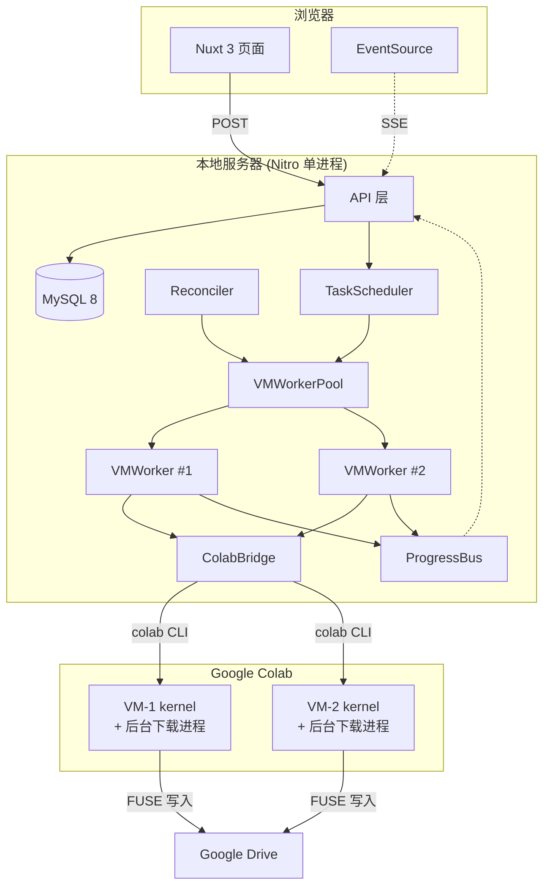
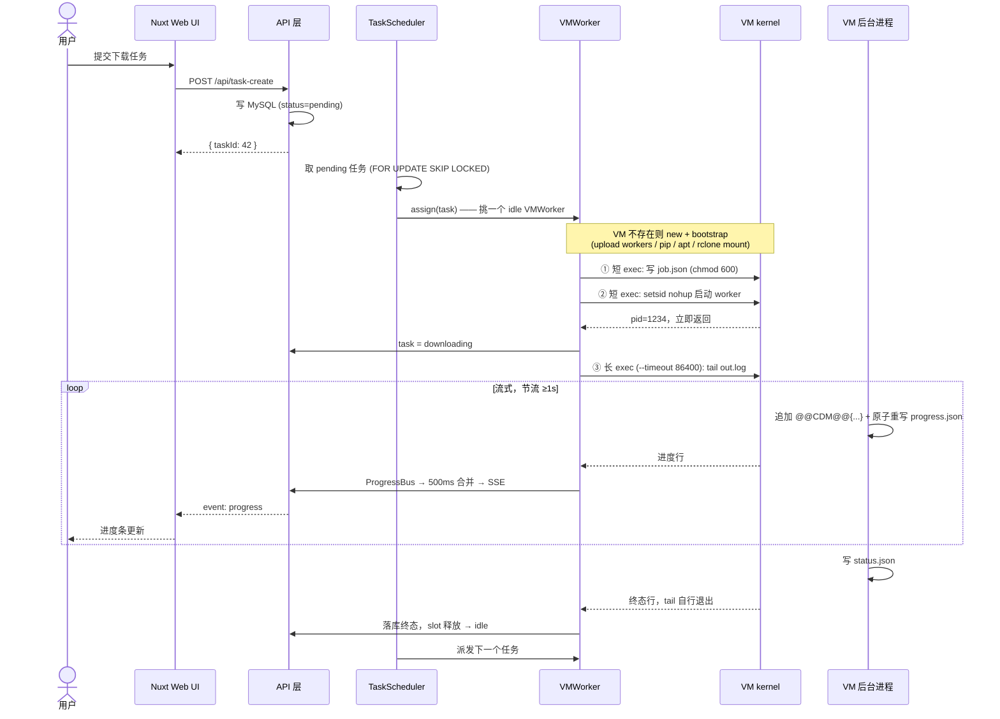

# Colab Download Manager — 软件开发任务规划

> 利用 Google Colab 高速网络（200-500 MB/s）批量下载文件到 Google Drive 的 Web 管理平台

> **配套文档：[DESIGN.md](./DESIGN.md)** —— 详细设计（架构、状态机、协议、实测约束）。
> 本文档回答「做什么、什么时候做、怎么算做完」；DESIGN.md 回答「怎么做、为什么这么做」。

---

## 1. 项目概览

### 1.1 核心价值

| 痛点 | 解决方案 |
|:---|:---|
| 本地网络慢，大模型下载要几小时 | Colab 数据中心内网下载，**实测 90-175 MB/s，39GB 约 4-6 分钟** |
| 下载完还要上传到 Drive，二次耗时 | Colab → Drive 是内网传输，几乎零延迟 |
| 手动操作 Colab 繁琐 | Web UI 一键提交任务，自动管理 VM 生命周期 |
| 下载中断需要重来 | 任务队列持久化，支持断点续传和自动重试 |

> ⚠️ **前置条件**：Google Drive 免费空间仅 15GB。要下载 39GB 级别的模型，账号必须有足够的 Drive 空间（Google One）。系统会在下载前预检并快速失败，详见 [DESIGN.md §13.1](./DESIGN.md#131-下载前预检必须快速失败)。

### 1.2 技术栈

| 层 | 技术 | 说明 |
|:---|:---|:---|
| 前端 | **Nuxt 3** + TypeScript | SSR/CSR 混合，内置 API 路由 |
| 后端 | **Nuxt Server (Nitro)** + TypeScript | `server/api/` 目录即后端 |
| ORM | **TypeORM** | 实体映射、Migration |
| 数据库 | **MySQL 8** | 任务持久化、状态追踪 |
| Colab 交互 | **google-colab-cli 0.6.0**（子进程调用） | 会话管理、代码执行、文件操作 |
| 实时通信 | **Server-Sent Events (SSE)** | 前端实时接收下载进度 |
| 校验 | **zod** | API body 统一校验 |
| 日志 | **pino** | 结构化日志 + 脱敏 |
| 测试 | **vitest** + **Playwright** | 单测/集成/E2E |

### 1.3 约定规范

#### CSS 命名规则

```
class="container_页面名_模块名_位置名_功能名_别名"
```

```html
<div class="container_dashboard_statsPanel_top_card_pending">
<div class="container_tasks_taskTable_body_progress_bar">
<div class="container_vms_vmCard_header_status_idle">
```

补充规则：
- 状态类走**别名段**：`..._status_idle` / `..._status_busy`，用 `:class` 动态拼接。
- 组件内部根节点用**组件自身名**作模块名，保证跨页面复用时类名可预测。
- 只有布局与结构走这套命名；原子样式（间距、字号）走 `main.css` 工具类，不进命名体系。

#### API 路由规范

- **全部使用 POST 方法 + body 传参**，不使用 `[id].ts` 动态路由。
- 路由文件命名为描述性名称（如 `task-create.post.ts`）。
- **唯一例外**：`progress-stream.get.ts`（SSE 协议要求 GET）。

```
✅  POST /api/task-detail     body: { taskId: 123 }
✅  POST /api/vm-stop         body: { vmId: 3 }
✅  GET  /api/progress-stream （唯一例外，SSE）
❌  GET  /api/task/[id].ts    （禁止）
```

#### 统一响应包络

```ts
{ code: 0, data: T }                                 // 成功
{ code: 40001, message: "任务不存在", detail?: any }  // 失败
```
错误码段位：`4xxxx` 客户端 / `5xxxx` 服务端 / `6xxxx` Colab 侧（认证、配额、session 丢失）。

---

## 2. 架构设计

> 完整设计见 [DESIGN.md §3](./DESIGN.md#3-总体架构)。此处只列开发者必须先建立的心智模型。

### 2.1 系统架构图



### 2.2 三条必须先记住的规则

**① 一个 VM = 一个 Worker = 一个任务（单槽）**

一个 Colab session 只有**一个 Jupyter kernel**，同时只能执行一段代码。所以 VM 内部**不可能排队**，队列只存在于中心 DB。并行度 = VM 数量。

```
中心队列(DB) → TaskScheduler 派发 → VMWorker(单槽) → VM 上 1 个下载进程
```

**② 下载进程与本地连接彻底解耦（两段式 exec）**

```
① 短 exec：写 job.json                       秒级返回
② 短 exec：setsid nohup 启动后台下载进程       秒级返回，kernel 随即空闲
③ 长 exec：tail out.log 流式读进度（--timeout 86400，绝不用 0）
           ↑ 这一段断了不影响下载，带 offset 重连即可断点续读
```

**③ 真相来源是 VM 上的文件，不是内存**

断连/重启后恢复任务状态，按此顺序判定：
`status.json 存在` → 采用其终态 ▸ 否则 `worker.pid 进程活着` → 继续 tail ▸ 否则 → 判失败。

### 2.3 核心流程



---

## 3. 数据库设计

> 完整 ER 图与字段变更理由见 [DESIGN.md §9](./DESIGN.md#9-数据模型)。

### 3.1 实体清单

| 实体 | 说明 | 相对初版 |
|:---|:---|:---|
| `Task` | 下载任务 | 大幅扩充（见 3.2） |
| `TaskFile` | 任务下的单个文件 | **🆕** HF repo 是多文件，单一 progress 表达不了 |
| `VM` | Colab 会话 | 删除队列字段，改单槽 |
| `DownloadLog` | 任务日志 | 加 `source` + 索引 + 保留策略 |
| `Credential` | 凭据（**rclone Drive token** / HF / GitHub） | **🆕** 初版完全缺失；rclone token 是 Drive 接入的前提，HF token 是 gated repo 的前提 |
| `Setting` | 系统配置 | `key` → `config_key`（避 MySQL 保留字） |

### 3.2 关键字段变更

| 变更 | 原因 |
|:---|:---|
| **删除** `VM.queue_size` / `VM.max_queue` | 一个 session 只有一个 kernel，VM 内无法排队 |
| **新增** `VM.config_path` | 并行调 CLI 必须用 `--config` 隔离 `sessions.json`，否则状态文件竞争 |
| **新增** `VM.expires_at` | Colab 有 24h keep-alive 硬上限，设为 `created_at + 23h` 主动规避 |
| **新增** `VM.last_heartbeat_at` | 区分"下载很慢"和"进程死了" |
| `VM.gpu_type` → `runtime_type` | 实测支持 `T4/L4/G4/H100/A100` + TPU `v5e1/v6e1`，初版枚举不全 |
| `VM.status` 增加 `bootstrapping`/`awaiting_drive_auth`/`reconnecting`/`draining` | bootstrap 约 90-110s（含 ~30s 人工授权）；授权是独立阻塞态，必须能被页面看见；断连恢复不能算失败 |
| **新增** `VM.drive_backend` / `VM.drive_root` | Drive 接入方式抽象（默认 `colab_native`），Worker 只认 `drive_root` 变量 |
| **新增** `VM.drive_auth_state` / `VM.drive_authorized_at` | 授权状态机（`none`/`requesting`/`awaiting_user`/`propagating`/`mounted`/`lost`/`timeout`/`failed`），页面据此渲染徽标与按钮 |
| `Task.dest_path` 语义固定为**相对路径** | 与 `drive_root` 拼接在 VMWorker 侧完成，切换 Drive backend 无需迁移历史数据 |
| **新增** `Task.allow_patterns`/`ignore_patterns` | HF 大仓只要 `.safetensors` 是刚需，否则一个仓库拖 200GB |
| **新增** `Task.revision` | HF 需指定分支/tag/commit |
| **新增** `Task.error_code` | 区分可重试与不可重试，避免无意义重试烧算力 |
| **新增** `Task.log_offset` | 断连后从断点续读 `out.log` |
| **新增** `Task.priority`/`next_retry_at`/`cancel_requested`/`started_at`/`resume_offset` | 调度与 UI 必需 |
| `Task.speed`(string) → `speed_bps`(bigint) | 字符串没法排序/聚合/画图，格式化是前端的事 |

### 3.3 下载源类型

| source_type | source_url 格式 | 云端命令 | 断点续传 | 状态 |
|:---|:---|:---|:---|:---|
| `huggingface` | `Comfy-Org/MiniMax-H3`（可带 revision / patterns） | `huggingface_hub.snapshot_download` | ✅ resume_download | P0 |
| `http` | `https://example.com/model.safetensors` | `requests` + Range / `aria2c` | ✅ Range 206 | P0 |
| `github` | `owner/repo@tag` 或 Release URL | GitHub API + Range 下载 | ✅ | P1 |
| `gdrive` | Drive 分享链接 | `gdown` | ❌ 失败即重来 | P1 |
| `torrent` | `magnet:?xt=...` / `.torrent` | `aria2c --bt-*` | ✅ | 🔒 **默认禁用** |

> 🔒 **torrent 合规风险**：Google Colab 服务条款**明确禁止** torrent 与 P2P 文件共享，实现该源类型存在账号封禁风险。因此 `setting.enable_torrent` 默认 `false`，不在 UI 下拉中出现，手动开启时弹风险确认。这是产品决策 —— 如果不需要，直接删掉 Phase 9 是最省事的选择。详见 [DESIGN.md §13.4](./DESIGN.md#134--合规torrent-源)。

### 3.4 索引与日志保留

```sql
INDEX idx_sched  (status, priority, id)        -- 调度热路径
INDEX idx_retry  (status, next_retry_at)       -- 退避唤醒
INDEX idx_list   (status, created_at)          -- 列表页
INDEX idx_log    (task_id, id)                 -- 详情页日志分页（无此索引会全表扫）
UNIQUE KEY uk_session (session_name)
```

日志保留：`setting.log_retention_days` 默认 14 天，Reconciler 每日清理；单任务硬上限 5000 条，超出后只保留 `warn`/`error`。

---

## 4. API 设计

> 完整清单与参数见 [DESIGN.md §10](./DESIGN.md#10-api-清单)。**🆕** 为相对初版新增 —— 初版的接口无法支撑第 5 节的页面需求。

### 4.1 任务管理

| 路由文件 | 说明 |
|:---|:---|
| `task-create.post.ts` | 创建任务 |
| `task-batch-create.post.ts` | 批量创建 |
| `task-parse-url.post.ts` **🆕** | URL 智能识别（创建页依赖） |
| `task-list.post.ts` | 列表（补齐时间范围、关键字、排序） |
| `task-detail.post.ts` | 详情（含文件列表） |
| `task-log.post.ts` **🆕** | 日志分页（LogViewer 依赖） |
| `task-update.post.ts` **🆕** | 改名称/路径/优先级（仅非终态） |
| `task-cancel.post.ts` | 取消 |
| `task-retry.post.ts` | 重试 |
| `task-delete.post.ts` | 删除 |
| `task-batch-action.post.ts` **🆕** | 批量取消/重试/删除（列表页依赖） |

### 4.2 VM 管理

| 路由文件 | 说明 |
|:---|:---|
| `vm-list.post.ts` | 列表 |
| `vm-detail.post.ts` **🆕** | 详情 + 最近事件 |
| `vm-create.post.ts` | 手动创建（`maxQueue` 参数删除） |
| `vm-stop.post.ts` | 停止（可选等当前任务跑完） |
| `vm-stop-all.post.ts` | 全部停止 |
| `vm-sync.post.ts` **🆕** | 与 `colab sessions` 手动对账（排障必备） |

### 4.3 系统 / Drive / 凭据

| 路由文件 | 说明 |
|:---|:---|
| `stats-overview.post.ts` **🆕** | Dashboard 统计（初版页面要但没接口） |
| `drive-list.post.ts` **🆕** | 浏览 Drive 目录（路径选择器依赖） |
| `drive-quota.post.ts` **🆕** | Drive 剩余空间（下载前预检） |
| `colab-auth-status.post.ts` **🆕** | 认证状态探活 + 修复建议 |
| `vm-drive-auth-start.post.ts` **🆕** | 启动 PTY 跑 `drivemount`，返回 `{authUri, expiresAt}`（幂等） |
| `vm-drive-auth-confirm.post.ts` **🆕** | 用户已授权 → 向挂起的 PTY 写回车 |
| `vm-drive-auth-cancel.post.ts` **🆕** | 放弃授权并杀 PTY |
| `vm-drive-auth-status.post.ts` **🆕** | 授权状态快照（首屏用；增量走 SSE `drive-auth`） |
| `vm-warmup.post.ts` **🆕** | 预热：一次开 N 台并逐台引导授权（睡前一次配好） |
| `drive-setup.post.ts` **🆕** | 仅 `rclone` 模式：提交 refresh_token 并加密入库 |
| `drive-test.post.ts` **🆕** | 试挂载/试列目录，返回诊断结果 |
| `setting-list.post.ts` **🆕** | 全部配置（设置页依赖） |
| `setting-get.post.ts` / `setting-update.post.ts` | 按 key 读 / 批量写 |
| `credential-list/upsert/delete.post.ts` **🆕** | 凭据管理（明文永不返回） |

### 4.4 实时数据

| 路由文件 | 说明 |
|:---|:---|
| `progress-stream.get.ts` | SSE，全项目唯一 GET。支持 `?tasks=` / `?scope=active` / `Last-Event-ID` |

---

## 5. 前端页面规划

### 5.1 页面结构

```
pages/
├── index.vue              # 仪表盘
├── tasks.vue              # 任务列表
├── task-create.vue        # 创建任务
├── vms.vue                # VM 管理
└── settings.vue           # 系统设置

layouts/default.vue        # 导航 + 全局 SSE 连接状态灯
error.vue                  # 全局错误页
```

### 5.2 页面功能

#### 页面 1: Dashboard (`index.vue`)
- **统计卡片**：总任务 / 进行中 / 已完成 / 失败 / 今日下载字节数（`stats-overview`）
- **活跃 VM**：当前任务、运行时长、`expires_at` 倒计时、剩余空闲时间
- **实时进度区**：正在下载的任务进度条（SSE 驱动）
- **最近完成**：最近 10 条
- **配额提示**：Drive 剩余空间、活跃 VM / 上限

#### 页面 2: 任务列表 (`tasks.vue`)
- **筛选栏**：状态 / 源类型 / **时间范围** / 关键字
- **任务表格**：名称、来源、目标路径、进度、速度、状态、操作
- **批量操作**：全选 → 批量取消 / 删除 / 重试（`task-batch-action`）
- **详情抽屉**：文件级进度列表 + 日志查看器（`task-detail` + `task-log`）

#### 页面 3: 创建任务 (`task-create.vue`)
- **单任务模式**：URL + 目标路径 + 高级项（revision / allow_patterns / 优先级 / 凭据）
- **批量模式**：逐行粘贴多个 URL → 识别结果表格预览 → 逐行可编辑 → 一次提交
- **智能识别**：`task-parse-url` 推断源类型、任务名、建议路径
- **目标路径选择器**：浏览 Drive 目录（`drive-list`）
- **提交前提示**：预估大小 vs Drive 剩余空间

#### 页面 4: VM 管理 (`vms.vue`)
- **VM 卡片**：状态徽标（🟠 需要授权 / 🔵 准备中 / 🟢 空闲·Drive 已挂载 / 🔵 下载中 / 🔴 Drive 失效）、当前任务、运行时长、到期倒计时
- **授权入口**：`awaiting_drive_auth` 时高亮主按钮 **[授权]**，点开 `DriveAuthPanel`
- **操作**：新建 VM / **预热 N 台并逐台授权** / 停止 / 强制停止 / 全部停止 / **手动对账**
- **策略配置**：空闲超时（默认 3600s）、最大并行 VM 数、孤儿 VM 处理策略、自动重建开关（默认关）

#### 页面 5: 系统设置 (`settings.vue`)
- **Colab 认证状态**：探活结果 + 失败时的具体修复命令
- **Drive 授权总览**（`colab_native` 默认模式）：列出全部 VM 的授权状态、授权时间、到期时间，一处纵览；含通知开关（浏览器通知/提示音/标题闪烁）
- **Drive 接入方式**（`drive_backend`）：默认 `colab_native`（每台 VM 授权一次，无长期凭据落 VM）；可切换 `rclone`（全系统一次，但需把 refresh_token 写进 VM，切换时明确提示该风险）
- **凭据管理**：HF token / GitHub token 增删改（只显示末 4 位）
- **默认值**：目标路径、下载模式（direct/staged）、最大并行 VM、最大重试、空闲超时
- **访问控制**：访问 token（暴露到局域网时必开）
- **高级**：日志保留天数、torrent 开关（带风险确认）

### 5.3 进度展示链路

> 完整设计见 [DESIGN.md §8](./DESIGN.md#8-进度展示链路)。

**三级节流**（防止 500MB/s 下载把系统打垮）：

| 层 | 频率 |
|:---|:---|
| VM worker → stdout | ≥ 1s |
| ProgressBus → SSE | 500ms，同任务只保留最新 |
| ProgressBus → MySQL | 5s，或状态变更时立即 |

**必须实现的细节**（缺一个就会出现"进度卡住"类 bug）：
- SSE 每 15s 发一个 `: heartbeat` 注释帧（否则代理会掐 60s 空闲连接）。
- 响应头必须带 `X-Accel-Buffering: no`。
- 首屏先用 `task-list` 拉快照渲染，再让 SSE 增量覆盖（否则刷新页面进度条归零）。
- 全站**单例** EventSource，不是每个组件一条。
- SSE `reconnecting` 超 10s → 降级为 5s 轮询兜底。
- 进度条状态：`total` 未知 → 不定态动画；`reconnecting` → 半透明 + "恢复中"且**不清零**；`retry_wait` → 倒计时。

---

## 6. 目录结构

```
colab-download-manager/
├── nuxt.config.ts · package.json · tsconfig.json
├── docker-compose.yml              # MySQL 8（Nuxt 不容器化，见下方警告）
├── .env.example
├── TASK.md · DESIGN.md
│
├── server/
│   ├── api/                        # 见 §4
│   │
│   ├── plugins/                    # 🆕 Nitro 启动钩子（初版缺失，调度器无处挂载）
│   │   ├── 00.database.ts
│   │   ├── 10.reconciler.ts        # 启动对账，必须先于调度器
│   │   └── 20.scheduler.ts         # 调度器（单例守卫）
│   │
│   ├── core/                       # 🆕 运行时核心
│   │   ├── VMWorker.ts             # 一 VM 一 Worker 主体
│   │   ├── VMWorkerPool.ts
│   │   ├── TaskScheduler.ts
│   │   ├── Reconciler.ts
│   │   ├── ProgressBus.ts
│   │   ├── DriveAuthManager.ts     # 🆕 PTY 授权会话管理
│   │   └── ProtocolParser.ts       # @@CDM@@ 行协议解析
│   │
│   ├── services/
│   │   ├── TaskService.ts · VMService.ts · SettingService.ts
│   │   ├── CredentialService.ts    # 🆕 加解密
│   │   ├── DriveService.ts         # 🆕 目录浏览 / 配额
│   │   └── UrlParser.ts            # 🆕 URL 智能识别
│   │
│   ├── colab/                      # 🆕 CLI 封装层
│   │   ├── ColabBridge.ts          # 接口
│   │   ├── RealColabBridge.ts · MockColabBridge.ts
│   │   └── templates/              # 下发到 VM 的代码模板
│   │       ├── write_job.py.tpl · launch_worker.py.tpl
│   │       ├── tail_stream.py.tpl · kill_worker.py.tpl
│   │       └── preflight.py.tpl
│   │
│   ├── entities/                   # Task/TaskFile/VM/DownloadLog/Setting/Credential
│   ├── migrations/
│   │
│   ├── workers/                    # upload 到 VM 的 Python 包
│   │   ├── worker_base.py          # 行协议、节流、原子写、Drive 工具
│   │   ├── worker_main.py          # 入口：读 job.json → 分发
│   │   ├── src_huggingface.py · src_http.py
│   │   ├── src_github.py · src_gdrive.py
│   │   └── src_torrent.py          # 🔒 默认禁用
│   │
│   └── utils/
│       └── db.ts · logger.ts · validate.ts · crypto.ts · response.ts
│
├── shared/types/                   # 🆕 前后端共享类型
│   └── task.ts · vm.ts · progress.ts · api.ts
│
├── pages/ · layouts/ · components/ · composables/ · assets/ · public/
├── scripts/preflight.sh · scripts/migrate.sh
└── tests/unit/ · tests/integration/ · tests/e2e/
```

> ⚠️ **不要把 Nuxt 服务容器化**：它需要访问宿主机的 `colab` 可执行文件和 `~/.config/gcloud`（ADC 凭据）。容器化会把认证、TTY、状态文件隔离三个问题同时放大。只容器化 MySQL。

---

## 7. 分阶段开发任务

**总览：Phase 0 是硬前置，未通过不进入 Phase 1。**

### Phase 0: 技术验证（Spike）⏱️ ~2天 ✅ **已执行，报告见 [docs/spike-report.md](./docs/spike-report.md)**

> 目的：在写 20 天代码之前，先用手工命令跑通整条链路。下面每一项失败都会推翻一部分架构，**必须先验证**。

| # | 验证项 | 验收标准 |
|:--|:---|:---|
| 0.1 | Colab 认证 | ✅ `--auth oauth2` 可用；`colab new`(CPU) **15.9s**；并发 session **≥2** |
| 0.2 | drivemount 授权可持久化 | ❌ **已证伪**（每台新 VM 都要人工），产品决策：接受并做页面引导 |
| 0.2b | **PTY 捕获授权 URI + 写回车** | ✅ `script -qec` 即可，**无需 node-pty**；纯管道必死于 `/dev/tty`。捕获 5.8s，确认后 11s 挂载 |
| 0.2c | 授权 URI 特征 | ✅ **1415 字符**，`state` 内含 VM endpoint（授权绑定 VM 的铁证）。UI 需折叠+复制+大二维码 |
| 0.2d | **ephemeral 凭据 TTL** | 🕐 **观测中**，已连续 15min 正常。>2h 则长下载安全；<1h 则挂载失效恢复必做 |
| 0.3 | worker 包投递 + 跨文件 import | ⚠️ 通过，但发现两个坑：`upload` **不建父目录**（500 错误）、kernel 缓存毒化需 `importlib.invalidate_caches()` |
| 0.4 | 参数化下发（管道喂代码） | ✅ 参数完整送达，`@@CDM@@` 前缀正常 |
| 0.5 | 两段式执行 | ✅ 启动 exec **4.8s 返回**，kernel 立即释放 |
| 0.6 | 断连恢复 | ✅ 强杀本地进程 12s，worker 照跑；`offset` 续读 **seq 1→63 零缺失** |
| 0.7 | 真实下载到 Drive | ⚠️ 通过，但**吞吐远低于宣称值**：默认 HF→Drive 仅 93.4 MB/s，`aria2c -x8` 达 174 MB/s |
| 0.8 | 依赖安装耗时 | ✅ `pip huggingface_hub` 4.6s，`apt aria2` ~15s |
| 0.9 | `--config` 并发隔离 | ✅ 全程未影响默认 `sessions.json`，用户已有的 L4 会话无感 |
| 0.10 | 取消链路 | ✅ `restart-kernel` **不杀** detached worker；SIGTERM 2s 内终止 |
| 0.11 | 脏输出耐受 | 🔴 **发现协议解析规则错误**：`@@CDM@@` 会被 `\r` 输出挤到行中间 |
| **0.12** | **`--timeout 0` 语义** | 🔴 **重大发现**：不是无限，只给 30 秒。必须传显式大正数 |

**产出**：[`docs/spike-report.md`](./docs/spike-report.md) ✅ 已完成 —— 含全部实测数据、根因分析与设计修正。验证脚本在 `spike/`。

**决策门**：
- **0.2 已判定，主方案确定为 `colab_native` + 页面授权引导**（用户已确认接受每台 VM 授权一次）。
- 0.2b 失败（PTY 也拿不到授权 URI）→ 退到 rclone 无人值守模式（[DESIGN.md §6.0.7](./DESIGN.md#607-可选方案-b-rclone-无人值守模式)），Phase 3 工期 +1 天。
- 0.2d 测出 TTL < 1h → §6.0.6 的挂载失效恢复从「保险」升级为「必做」，Phase 4 +1 天。
- 0.5 或 0.6 失败 → 退回单段长 exec，并接受"服务重启即丢任务"，需在 UI 明确告知。

---

### Phase 1: 基础框架 ⏱️ ~2天

| # | 任务 | 产出 |
|:--|:---|:---|
| 1.1 | Nuxt 3 + TypeScript + zod + pino 初始化 | `nuxt.config.ts`, `tsconfig.json` |
| 1.2 | MySQL docker-compose + TypeORM 数据源 | `docker-compose.yml`, `server/utils/db.ts`, `.env.example` |
| 1.3 | 6 个实体定义（Task/TaskFile/VM/DownloadLog/Setting/Credential） | `server/entities/*.ts` |
| 1.4 | Migration 生成与运行 + 索引 | `server/migrations/` |
| 1.5 | 共享类型定义（前后端复用） | `shared/types/*.ts` |
| 1.6 | 统一响应包络 + zod 校验中间件 + 错误码表 | `server/utils/response.ts`, `validate.ts` |
| 1.7 | 日志工具 + 脱敏正则（token/hf_*/ghp_*） | `server/utils/logger.ts` |
| 1.8 | 凭据加解密工具（AES-256-GCM） | `server/utils/crypto.ts` |
| 1.9 | 全局 CSS 设计系统 + 布局组件 | `assets/css/main.css`, `layouts/default.vue`, `error.vue` |
| 1.10 | `preflight.sh`：检查 colab 可执行 / 认证 / MySQL / 密钥 | `scripts/preflight.sh` |

**DoD**：`npm run dev` 起得来；migration 可重复执行；`preflight.sh` 能准确报出缺失项；日志中 token 已打码。

---

### Phase 2: 任务管理核心 ⏱️ ~3天

| # | 任务 | 产出 |
|:--|:---|:---|
| 2.1 | TaskService — CRUD + 状态机迁移校验（非法迁移抛错） | `server/services/TaskService.ts` |
| 2.2 | UrlParser — 5 种源的识别与归一化（HF 的 `resolve/main` 形式、GitHub Release URL 等） | `server/services/UrlParser.ts` |
| 2.3 | 任务 API（create/batch-create/parse-url/list/detail/log/update/cancel/retry/delete/batch-action） | `server/api/task-*.post.ts` |
| 2.4 | 创建任务页 — 单任务 + 批量 + 识别预览 + 高级项 | `pages/task-create.vue` |
| 2.5 | 任务列表页 — 表格 + 筛选 + 分页 + 批量操作 + 详情抽屉 | `pages/tasks.vue` |
| 2.6 | `useTaskApi` + `useApi`（统一包络/错误 Toast） | `composables/*.ts` |
| 2.7 | 单测：UrlParser、状态机迁移合法性 | `tests/unit/` |

**DoD**：不接 Colab 也能完整走通任务 CRUD；粘贴 10 个混合 URL 能全部正确识别；非法状态迁移被拒绝并有测试覆盖。

---

### Phase 3: ColabBridge + VMWorker ⏱️ ~4天

| # | 任务 | 产出 |
|:--|:---|:---|
| 3.1 | ColabBridge 接口 + Real 实现（new/exec/execTemplate/upload/install/status/sessions/stop/restart-kernel），含 `--config` 隔离、显式 `--auth`、CLI 原始输出留存 | `server/colab/RealColabBridge.ts` |
| 3.2 | **MockColabBridge** — 走完全相同的行协议与状态机，支持故障注入 | `server/colab/MockColabBridge.ts` |
| 3.3 | 代码模板与渲染（变量一律 `JSON.stringify` 内嵌，杜绝注入） | `server/colab/templates/*.tpl` |
| 3.4 | VMWorker — 状态机（含 `awaiting_drive_auth`）、bootstrap（upload/pip/apt/授权/挂载探针）、空闲回收、`expires_at` 提前提醒与强制停机 | `server/core/VMWorker.ts` |
| 3.5 | VMWorkerPool + VMService；调度保守化（`idle_timeout` 3600s、关自动重建、一次只开 1 台待授权 VM） | `server/core/VMWorkerPool.ts` |
| **3.6** | **DriveAuthManager** ⭐核心：PTY 会话注册表、URI 正则提取、写回车确认、成功双重判定（`Credentials propagated` + `Mounted at` + 挂载探针）、600s 倒计时与超时清理、幂等、服务重启后重置、全量输出留档 | `server/core/DriveAuthManager.ts` |
| 3.6b | 授权 API：`vm-drive-auth-start/confirm/cancel/status` + `vm-warmup` | `server/api/vm-drive-auth-*.post.ts` |
| 3.6c | SSE `drive-auth` 事件接入 ProgressBus | `ProgressBus.ts` |
| 3.6d | **`DriveAuthPanel.vue`**：打开授权页 / 复制链接 / 二维码 / 「我已完成授权」/ 倒计时 / 实时状态行 / 原始错误展示 | `components/DriveAuthPanel.vue` |
| 3.6e | **`DriveAuthBanner.vue`**：全局常驻横幅（任一 VM 待授权即显示，带剩余时间与跳转） | `layouts/default.vue` |
| 3.6f | **主动通知**：浏览器 Notification（含权限申请）、页面标题闪烁、提示音（可关） | `composables/useDriveAuth.ts` |
| 3.6g | VM 卡片授权状态徽标 + 授权/重新授权按钮；设置页授权总览 | `pages/vms.vue`, `pages/settings.vue` |
| 3.7 | VM API（list/detail/create/stop/stop-all/sync） | `server/api/vm-*.post.ts` |
| 3.8 | VM 管理页 + `useVMApi` | `pages/vms.vue` |
| 3.9 | 认证状态检查接口 + 设置页对应区块 | `colab-auth-status.post.ts` |

**DoD**：`CDM_MOCK=1` 下 VM 全生命周期可跑（含模拟授权）；真实模式下 **从点「新建 VM」到看见授权链接 ≤ 60s，点完授权后 ≤ 20s 进入 `idle`**；切到别的标签页时浏览器通知能正常弹出；服务重启后待授权 VM 能重新发起授权。

---

### Phase 4: 调度 + 下载执行（P0 源）⏱️ ~4天

| # | 任务 | 产出 |
|:--|:---|:---|
| 4.1 | TaskScheduler — `FOR UPDATE SKIP LOCKED` 取任务、派发、按需扩容、退避唤醒、单例守卫 | `server/core/TaskScheduler.ts` |
| 4.2 | worker_base.py — 行协议输出、≥1s 节流、`progress.json` 原子写、Drive 工具、异常兜底 | `server/workers/worker_base.py` |
| 4.3 | worker_main.py — 读 `job.json` 分发、终态写 `status.json`、信号处理（SIGTERM 优雅退出） | `server/workers/worker_main.py` |
| 4.4 | 预检脚本 — Drive 剩余空间 / VM 磁盘 / 凭据 | `templates/preflight.py.tpl` |
| 4.4b | **挂载存活探测**：worker 每 60s 写删探针，失效则以 `DRIVE_MOUNT_LOST` 退出 | `worker_base.py` |
| 4.5 | src_huggingface.py — snapshot_download + patterns + revision + resume + token | `server/workers/src_huggingface.py` |
| 4.6 | src_http.py — Range 续传 + 重定向 + 无 Content-Length 处理 | `server/workers/src_http.py` |
| 4.7 | 两段式执行 + tail 流式接收 + 断连重连（带 offset） | `VMWorker` 增强 |
| 4.8 | 取消链路（restart-kernel → kill → 写终态 → 清理） | `VMWorker` 增强 |
| 4.9 | ProtocolParser — `@@CDM@@` 解析，脏行降级为日志，永不崩 | `server/core/ProtocolParser.ts` |
| 4.10 | 凭据管理 API + 设置页表单 | `credential-*.post.ts` |

**DoD**：端到端下载一个真实 HF 模型成功落到 Drive；下载途中断网 30s 能自动恢复且进度不丢；取消能真正杀掉 VM 上的进程；ProtocolParser 对 tqdm `\r` 刷屏输出有测试覆盖。

---

### Phase 5: 实时进度推送 ⏱️ ~2天

| # | 任务 | 产出 |
|:--|:---|:---|
| 5.1 | ProgressBus — 三级节流、事件环形缓冲（200 条，供 `Last-Event-ID` 补发） | `server/core/ProgressBus.ts` |
| 5.2 | SSE 端点 — `?tasks=` / `?scope=` 订阅、心跳注释帧、`X-Accel-Buffering: no` | `server/api/progress-stream.get.ts` |
| 5.3 | `useProgress` — 单例 EventSource、指数退避重连、`Last-Event-ID`、轮询兜底、连接状态 | `composables/useProgress.ts` |
| 5.4 | TaskProgressBar — 未知总量/多文件/reconnecting/停滞/retry_wait 五种形态 | `components/TaskProgressBar.vue` |
| 5.5 | LogViewer — 虚拟滚动 + 自动滚底 + 级别过滤 | `components/LogViewer.vue` |
| 5.6 | ConnectionBadge — 全局连接状态灯 | `components/ConnectionBadge.vue` |

**DoD**：页面进度延迟 < 2s；刷新页面进度不归零；断网重连后不丢事件；开 3 个标签页只建 3 条连接且服务端 CPU 无明显上升。

---

### Phase 6: Dashboard + 设置 ⏱️ ~2天

| # | 任务 | 产出 |
|:--|:---|:---|
| 6.1 | `stats-overview` + Dashboard 页 | `pages/index.vue` |
| 6.2 | StatsCard / VMCard 组件 | `components/` |
| 6.3 | DriveService + `drive-list` / `drive-quota` + 路径选择器 | `components/DrivePathPicker.vue` |
| 6.4 | 设置 API（list/get/update）+ 默认值初始化 | `server/services/SettingService.ts` |
| 6.5 | 设置页完整实现（认证/授权/凭据/默认值/访问控制/高级） | `pages/settings.vue` |
| 6.6 | 访问 token 鉴权中间件 | `server/middleware/auth.ts` |

**DoD**：Dashboard 各项数字与 DB 一致；路径选择器能浏览真实 Drive 目录；开启访问 token 后未带 header 的请求全部 401。

---

### Phase 7: 健壮性与恢复 ⏱️ ~3天

| # | 任务 | 产出 |
|:--|:---|:---|
| 7.1 | Reconciler — 启动对账（`colab sessions` diff、孤儿 VM 策略、卡死任务判定、queued/preparing 退回） | `server/core/Reconciler.ts` |
| 7.2 | 周期性健康检查 — 心跳超时、`expires_at` 停机、空闲回收、retry_wait 唤醒 | `Reconciler` 增强 |
| 7.3 | 重试与退避 — `error_code` 分类、不可重试短路、换 VM 重试、携带 `resume_offset` | `TaskScheduler` 增强 |
| 7.3b | **`DRIVE_MOUNT_LOST` 恢复链路**：任务转 `retry_wait`（不消耗重试次数）→ VM 转 `awaiting_drive_auth` → 用户重授权 → 原 VM 上凭 `resume_offset` 续传 | `VMWorker` + `TaskScheduler` |
| 7.4 | 断点续传 — `direct`/`staged` 双模式 | Worker 增强 |
| 7.5 | 并发上限自适应 — `colab new` 配额失败时动态下调 `max_vms` | `VMWorkerPool` 增强 |
| 7.6 | 日志保留清理任务 | `Reconciler` 增强 |
| 7.7 | 全局错误处理 + Toast + 降级横幅（认证失效时停止派发） | 全局 |
| 7.8 | 集成测试：崩溃恢复、断连、session 丢失、20 任务 2 VM 排队 | `tests/integration/` |

**DoD**：五个边界场景（[DESIGN.md §15.2](./DESIGN.md#152-测试)）全部通过；`kill -9` Nuxt 后重启，正在下载的任务能恢复。

---

### Phase 8: 扩展下载源 ⏱️ ~2天

| # | 任务 | 产出 |
|:--|:---|:---|
| 8.0 | **rclone 无人值守模式（可选）** — token 加密存取、`rclone.conf` 下发、`rclone mount --daemon`、与 `colab_native` 共用 `drive_root` 抽象 | `templates/rclone_setup.py.tpl` |
| 8.1 | src_github.py — Release API + 资产筛选 + token | `server/workers/src_github.py` |
| 8.2 | src_gdrive.py — gdown 单文件/文件夹（明确不支持续传） | `server/workers/src_gdrive.py` |
| 8.3 | UrlParser 补齐这两类的识别 | `UrlParser.ts` |

**DoD**：两类源各完成一次真实下载。

---

### Phase 9: torrent 源 🔒 ⏱️ ~1天（可选，建议直接删除）

| # | 任务 | 产出 |
|:--|:---|:---|
| 9.1 | src_torrent.py — aria2c BT + 进度解析 | `server/workers/src_torrent.py` |
| 9.2 | `enable_torrent` 开关 + 风险确认弹窗 + 默认隐藏 | `pages/settings.vue` |

> 🔒 违反 Colab 服务条款、有封号风险。**默认关闭**。不需要就删掉本 Phase。

---

### Phase 10: E2E 与交付 ⏱️ ~2天

| # | 任务 | 产出 |
|:--|:---|:---|
| 10.1 | Playwright E2E（`CDM_MOCK=1`）：创建→进度→完成 / 取消 / 重试 / SSE 断连 | `tests/e2e/` |
| 10.2 | `.env.example` 完善 + `migrate.sh` + README 部署与授权说明 | `scripts/`, `README.md` |
| 10.3 | 性能：1000 条任务的列表分页、日志虚拟滚动、SSE 多标签页 | — |
| 10.4 | 全量真实场景验收 | `docs/acceptance.md` |

**DoD**：全新机器按 README 从零跑通，含 rclone 凭据配置；配好后连开 3 台 VM 零人工。

---

## 8. 进度上报协议 v2

> 完整定义见 [DESIGN.md §7](./DESIGN.md#7-进度上报协议-v2)。

### 8.1 行格式

```
@@CDM@@{"v":1,"tid":42,"seq":137,"ts":1754700000.123,"type":"progress",...}
```

**魔法前缀 `@@CDM@@` 不可省略。** `huggingface_hub`、`aria2c`、tqdm 都会往同一个 stdout 喷自己的输出，初版的"纯 JSON 每行"方案必崩。

🔴 **但不能假设它在行首。** Phase 0 实测抓到：

```
[tqdm-noise] 70% |####      | 35/60 [00:05<00:00]@@CDM@@{"v":1,"tid":42,...}
```

`\r` 风格输出不带换行，会把前缀挤到行中间。解析器必须**扫描行内所有出现位置**（`matchAll`），用 `startsWith` 会漏。

### 8.2 消息类型

```python
{"type":"hello","pid":1234,"source_type":"huggingface","files_planned":7}

{"type":"progress","downloaded":1073741824,"total":10737418240,
 "speed_bps":268697600,          # 数值，非字符串 —— 格式化是前端的事
 "eta_sec":38,"file":"model.safetensors","file_index":3,"file_total":7}

{"type":"file","file":"config.json","bytes":1024,"status":"done"}
{"type":"log","level":"info","message":"开始下载 model.safetensors"}
{"type":"heartbeat","downloaded":1073741824}     # ≥30s 一条，证明进程活着

{"type":"status","status":"completed","bytes":10737418240,"duration_sec":142,
 "dest":"/content/drive/MyDrive/downloads/MiniMax-H3"}
{"type":"status","status":"failed","error_code":"DRIVE_QUOTA_EXCEEDED",
 "error":"Drive 剩余空间不足：需要 39.2GB，可用 8.1GB"}
```

### 8.3 硬性约束

| 约束 | 理由 |
|:---|:---|
| `progress` 类型 **≥1s 一条** | CLI 客户端会把所有输出无上限累积在内存，高频输出会让长任务把本地内存吃爆 |
| 每行必带 `tid` + 单调 `seq` | 归属与去重 |
| 每次 `progress` 同时**原子重写** `progress.json` | 断连恢复的真相来源 |
| 终态必须写 `status.json` | 幂等判定的唯一依据 |
| 凭据绝不出现在任何输出中 | 安全 |

---

## 9. 关键设计决策

| 决策点 | 选择 | 理由 |
|:---|:---|:---|
| 不直接调 Colab API | 封装 `colab` CLI 子进程 | CLI 已处理认证/保活/WebSocket |
| VM 内是否排队 | **否，一 VM 一 Worker 单槽** | 一个 session 只有一个 kernel，VM 内排队物理上不存在；队列上移到中心 DB |
| 长任务如何执行 | **两段式：后台进程 + 可重连 tail** | 单段长 exec 会因本地断连导致任务永久卡死；两段式下 VM 进程与本地连接彻底解耦 |
| exec 超时 | **显式大正数**：流式 tail `--timeout 86400`，短命令 `--timeout 120` | 🔴 实测 `--timeout 0` **不是无限，只给 30 秒**（CLI bug：0→None→回落 `REQUEST_TIMEOUT=30`）。且它是总时长预算而非空闲超时，持续输出也救不了 |
| 下载工具 | HTTP 用 `aria2c -x8`；HF 启用 `hf_transfer` | 实测单连接仅 30 MB/s，`-x8` 达 174 MB/s（`-x16` 反降）；`hf_transfer` 把 Drive 写入损耗从 18% 降到 5% |
| Worker 依赖如何投递 | bootstrap 时 `colab upload` 整个 workers 包 | `exec -f` 只发单文件，`import worker_base` 会 ImportError |
| 参数如何传给远端脚本 | 模板渲染 + 管道喂 exec；参数走 `job.json` | `exec -f` 不支持传参 |
| CLI 状态隔离 | 每 VM 一个 `--config` 文件 | 并行调用会竞争 `sessions.json` |
| `--auth` | **显式传 `oauth2`** | 实测默认值是 `oauth2`（`cli.py:78`），官方 skill 文档写的 `adc` 是错的；显式传避免版本漂移 |
| **Drive 如何接入** | **`colab drivemount` + 页面授权引导**（默认） | 实测授权**每台新 VM 都要人工点一次**且不可持久化。产品决策：接受这个成本，换来「不必把长期 Drive token 写进 Colab VM」的安全性，且用户无需自建 OAuth client。代价是自动扩容/重建/到期轮换需人工介入一次 |
| 授权 UX | 全局横幅 + 授权面板（链接/二维码/倒计时）+ 浏览器通知 + 标题闪烁 + 提示音 | 授权是阻塞点，**用户必须第一时间知道**。任务卡在 `queued` 时列表页直接显示"等待 VM 授权"并给跳转 |
| 调度保守化 | `idle_timeout` 3600s、关闭 VM 自动重建、一次只开 1 台待授权 VM、到期提前 1h 提醒 | VM 创建成本从「算力」变成「人的注意力」，必须尽量少打扰 |
| 挂载失效 | 专用 `DRIVE_MOUNT_LOST` 错误码，任务转 `retry_wait` 且**不消耗重试次数** | 凭据过期不是任务的错；否则一次过期会耗尽整队列的重试次数 |
| 无人值守怎么办 | 「预热」：睡前开好 2-3 台并授权，再提交队列 | 只要不触发重建或到期，全程无人工 |
| rclone 模式 | 保留为可选（Phase 8） | 确实需要完全无人值守时启用，但要接受长期 token 落到 VM 上 |
| SSE 而非 WebSocket | SSE | 单向推送足够，自带重连与 `Last-Event-ID` |
| Worker 用 Python | Colab 原生 Python | Node 脚本无法在 VM 中直接运行 |
| 默认 CPU 模式 | 下载不需要 GPU | 省算力，且 GPU 档位受订阅限制 |
| 全用 POST | 除 SSE 外无例外 | 项目约定 |
| 下载写入方式 | 默认 `direct`（直写 Drive） | 唯一支持跨 VM 续传的方式；`staged` 更快但不能续传，作为可选项 |
| 是否容器化 Nuxt | **否** | 需要宿主机的 colab CLI 与 gcloud 凭据 |
| torrent 源 | 默认禁用 | 违反 Colab ToS，有封号风险 |

---

## 10. 预计工期

| 阶段 | 工期 | 累计 |
|:---|:---|:---|
| **Phase 0: 技术验证** 🚧 | 2 天 | 2 天 |
| Phase 1: 基础框架 | 2 天 | 4 天 |
| Phase 2: 任务管理 | 3 天 | 7 天 |
| Phase 3: ColabBridge + VMWorker | 4 天 | 11 天 |
| Phase 4: 调度 + 下载执行 | 4 天 | 15 天 |
| Phase 5: 实时进度 | 2 天 | 17 天 |
| Phase 6: Dashboard + 设置 | 2 天 | 19 天 |
| Phase 7: 健壮性与恢复 | 3 天 | 22 天 |
| Phase 8: 扩展下载源 | 2 天 | 24 天 |
| Phase 9: torrent 🔒（可选） | 1 天 | 25 天 |
| Phase 10: E2E 与交付 | 2 天 | **27 天** |

> 初版估 18 天，未包含技术验证、恢复机制、凭据、测试与部署。删掉 Phase 9 并把 Phase 8 延后，**最小可用版本（P0 源 + 完整进度展示 + 恢复）为 22 天**。

> [!IMPORTANT]
> **Phase 0 不可跳过。** 0.2 已经证伪了最初的 Drive 方案（省下的返工远超验证成本），剩下 0.2b（rclone 可行性）、0.5（两段式执行）、0.6（断连恢复）任一失败都会再次推翻架构。

> [!TIP]
> Phase 1-2 完全不依赖 Colab，可与 Phase 0 并行开发。Phase 3 起 `CDM_MOCK=1` 模式能覆盖 90% 的开发调试，不必每次都真开 VM 烧算力。
